# دليل الـ dashboards في FunnelStream: كل panel في Grafana وكل visual في Power BI

الدليل ده بيشرح كل chart ورقم وجدول في الـ 6 dashboards بتوع Grafana وصفحات Power BI السبعة. لكل واحد بيقول: بيعرض إيه، وبيتحسب إزاي، وإزاي تقراه. مبني على تعريفات الـ dashboards في الـ repository (`monitoring/grafana/dashboards/*.json` و `scripts/make_pbip.py` و `dashboards/powerbi/measures.dax`) وعلى الـ screenshots في `docs/images`.

كل الأرقام في الـ screenshots جاية من بيانات محاكاة. screenshots الـ Grafana اتاخدت أثناء بروفة 13 أكتوبر 2026، وscreenshots الـ Power BI من التقرير بعد إعادة التصميم.

---

## 1. الأداتين بيتكاملوا إزاي

**ببساطة:** Grafana زي عدّاد السرعة في العربية: بيقولك دلوقتي إيه الحاصل. Power BI زي تقرير آخر الشهر: بيقولك إيه اللي حصل وإيه نقرر.

| | Grafana | Power BI |
|---|---|---|
| الجمهور | الـ engineers ومستخدم الـ operations | مستخدم الـ marketing والمديرين |
| السؤال | المنصة سليمة؟ وإيه اللي محتاج تصرف دلوقتي؟ | إيه اللي حصل؟ وإيه اللي نقرره؟ |
| مصدر البيانات | جداول Postgres صغيرة بيكتبها الـ live sink بعد كل Silver batch، والـ daily marts | جداول Gold في Databricks (11) وPostgres marts (7)، بـ import |
| الحداثة | بيتحدّث كل 5 ثواني (الـ dashboards اللحظية) أو كل دقيقة (الـ daily dashboards) | بيتحدّث يدويًا بعد Gold batch |
| Alerts | 8 alert rules | مفيش |

**ألوان Grafana.** الـ stat tiles والـ gauges بتغيّر لونها حسب الـ thresholds. الأخضر معناه سليم، البرتقاني معناه راقب، والأحمر معناه تصرّف. التايلات الزرقا هي أعداد عادية من غير حلو أو وحش. الشرطة المحايدة معناها مفيش بيانات. في charts النسب، الفجوة معناها مفيش بيانات في الدقيقة دي، مش صفر.

**تعريف واحد لليوم.** كل التواريخ بتوقيت القاهرة: إنفاق الإعلانات وclicks الإعلانات والـ orders والـ stock والـ demand.

**معنى "out of stock وقت ما الدقيقة اتكتبت".** الـ demand على الرفوف الفاضية بيتعلّم بمستوى الـ stock في اللحظة اللي الـ live sink كتب فيها الدقيقة دي، مش وقت الـ event. الـ replay أو الـ late event ممكن يعلّمه بشكل مختلف. فهو تقدير.

---

## 2. Grafana

6 dashboards بتتعمل provisioning كـ code. كل panel تحت مترتّب زي ما بيظهر على الشاشة.

### 2.1 FunnelStream: live pipeline (`fs-live`)

**الغرض.** بيبيّن إن الـ streaming pipeline عايش ونضيف. Refresh كل 5 ثواني، آخر 30 دقيقة.

**ببساطة:** هو "نبض" السيستم. لو النبض واقف، يبقى فيه مشكلة.

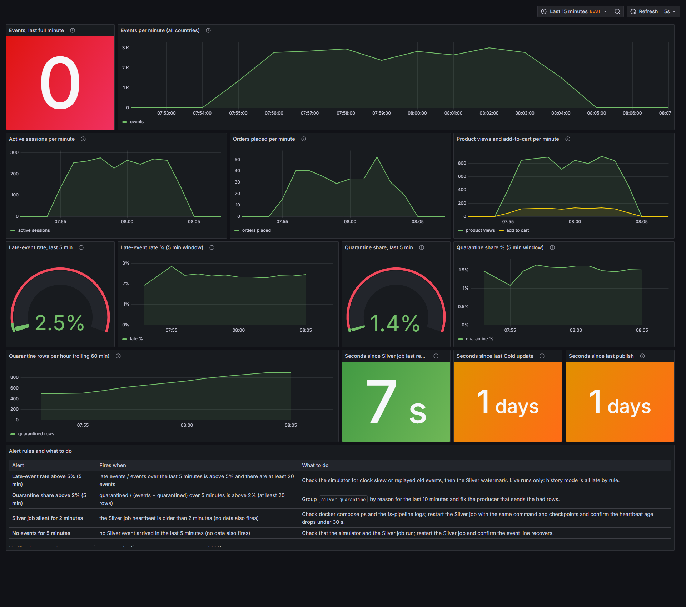

*اتاخدت في آخر بروفة 13 أكتوبر. المولّد كان لسه واقف، فـ events per minute بـ 0.*

| Panel | بيعرض إيه وبيتحسب إزاي | إزاي تقراه |
|---|---|---|
| Events, last full minute (stat) | الـ events اللي مش late ومش bot في آخر دقيقة كاملة، كل الدول. | أحمر عند 0، أخضر من 1 فما فوق. الصفر معناه إن الخط اللحظي مسطّح: الـ stream وقف أو الـ Silver job مش بيكتب. |
| Events per minute, all countries (time series) | نفس الـ events في الدقيقة من `live_metrics_minute`، مجموعة على الدول. | نبض الـ stream. الهضبة الناعمة معناها ترافيك سليم. النزول للصفر معناه إن الـ stream وقف. في الـ screenshot الخط بيطلع لحوالي 3,000 في الدقيقة وبينزل لصفر لما المولّد خلص. |
| Active sessions per minute | الـ sessions المميزة اللي كان فيها event في الدقيقة. | كام shopper موجود. المفروض يتبع خط الـ events. |
| Orders placed per minute | صفوف `order_created` في الدقيقة. | الـ conversion بشكل مرئي: الـ orders أقل بكتير من الـ sessions وبتعلى وتنزل مع الترافيك. |
| Product views and add-to-cart per minute | خطين: events مشاهدة الـ product وevents الـ add-to-cart في الدقيقة. | أعلى الـ funnel لحظيًا. الفجوة بين الخطين هي shoppers اتفرجوا ومضافوش للـ cart. |
| Late-event rate, last 5 min (gauge) | الـ late events مقسومة على كل الـ events في آخر 5 دقايق، كنسبة مئوية. | أخضر تحت 5%، أحمر من 5% فما فوق. الـ event بيبقى late لما يوصل Kafka بعد أكتر من 10 دقايق من وقته. الـ alert بيشتغل فوق 5%. في الـ screenshot بيقرا 2.5%. |
| Late-event rate %, 5 min window (time series) | نفس الـ late rate على نافذة 5 دقايق متحرّكة عبر الوقت، وخط أحمر عند حد 5%. | بيبيّن إذا كانت البيانات المتأخرة spike ولا مستوى ثابت. اقراه في التشغيلات اللحظية بس: الـ history replay بيبقى late بالقاعدة. |
| Quarantine share, last 5 min (gauge) | الصفوف المحجوزة مقسومة على events زائد الصفوف المحجوزة في آخر 5 دقايق. | أخضر تحت 2%، أحمر من 2%. دي نسبة الرسايل اللي الـ validator رفضها. الـ alert بيشتغل فوق 2%. بيقرا 1.4% في الـ screenshot. الـ simulator بيحقن صفوف وحشة قصدًا، فالنسبة الصغيرة الثابتة متوقعة. |
| Quarantine share %, 5 min window (time series) | نفس النسبة على نافذة متحرّكة، وخط أحمر عند 2%. | القفزة فوق مستوى الـ noise المحقون معناها إن producer بدأ يبعت بيانات وحشة. |
| Quarantine rows per hour, rolling 60 min | الصفوف المكتوبة في `silver_quarantine` في آخر 60 دقيقة، بتتحسب كل دقيقة. | حجم الصفوف المرفوضة. بيطلع باستمرار أثناء التشغيل لأن الـ noise ثابت. جمّع `silver_quarantine` حسب السبب عشان تشوف إيه اللي بيترفض. |
| Seconds since Silver job last reported (stat) | دلوقتي ناقص heartbeat الـ `silver_job`. الـ job بيبلّغ كل 15 ثانية وهو عايش وبعد كل batch. | أخضر تحت 30 ثانية، برتقاني من 30 لـ 120، أحمر فوق 120. ده الوقت من آخر مرة الـ job بلّغ، مش من آخر مرة وصلت بيانات. هو الرقم اللي بيشغّل alert "Silver job silent". في الـ screenshot هو 7 ثواني. |
| Seconds since last Gold update | دلوقتي ناقص heartbeat الـ `gold_build`. | أخضر تحت 24 ساعة، برتقاني من 24 لـ 48، أحمر فوق 48. مسار الـ batch بيشتغل عند الطلب، فالرقم بيكبر بين التشغيلات. بيعرض "1 days" في الـ screenshot. |
| Seconds since last publish | دلوقتي ناقص heartbeat الـ `publish` (رفع Silver لـ Databricks). | نفس الـ thresholds. بيقولك نسخة Databricks، وبالتالي Power BI، قديمة قد إيه. |
| Alert rules and what to do (text) | جدول الـ 8 alert rules، وإمتى كل واحد بيشتغل وتعمل إيه. | الـ runbook على نفس الشاشة مع الأرقام. |

### 2.2 FunnelStream: Operations, live inventory (`fs-inventory-ops`)

**الغرض.** صفحة مستخدم الـ operations: الـ stock دلوقتي، والـ demand اللي قابل رف فاضي، ووعد الـ express delivery. Refresh كل 5 ثواني، آخر 30 دقيقة.

**ببساطة:** هو "غرفة العمليات" للمخزن: إيه اللي خلص، وإيه اللي بيخلص، وإيه الـ orders اللي هتتأخر.

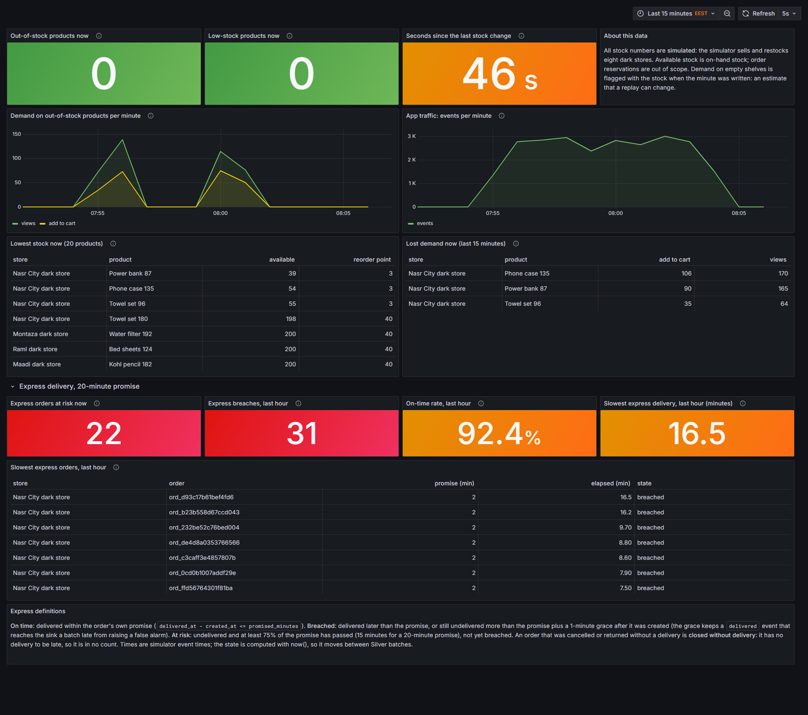

*قسم الـ express فيه breaches لأن البروفة استخدمت وعد دقيقتين وسلّمت بعض الـ orders متأخرة قصدًا.*

| Panel | بيعرض إيه وبيتحسب إزاي | إزاي تقراه |
|---|---|---|
| Out-of-stock products now (stat) | عدد أزواج store و product في `live_stock_now` اللي `available <= 0`. | أخضر عند 0، برتقاني من 1، أحمر من 5. كل واحد هو رف مفيش عليه حاجة يتباع. |
| Low-stock products now | الأزواج اللي stock فوق الصفر بس تحت reorder point بتاعتها. | أخضر تحت 10، برتقاني من 10، أحمر من 30. التحذير قبل الـ stock-out. |
| Seconds since the last stock change | عمر أحدث صف في `live_stock_now`. الـ stock بيتحسب تاني بعد كل Silver batch، فهو متأخر batch تقريبًا. | أخضر تحت 30 ثانية، برتقاني لحد 60، أحمر فوق. الرقم العالي معناه إن الـ stock مبقاش بيتحدّث. |
| About this data (text) | بيقول إن كل أرقام الـ stock محاكاة وإن علامات الـ demand تقديرات. | اقراه قبل ما تقتبس أرقام. |
| Demand on out-of-stock products per minute (time series) | مشاهدات الـ product وإضافات الـ cart اللي وصلت لـ store و product الـ stock بتاعهم صفر وقت كتابة الدقيقة. | ده الـ panel بتاع "الجسر". الـ spike معناه إن shoppers بيطلبوا حاجة الرف ميقدرش يخدمها. alert "Demand on out-of-stock products" مبني عليه. |
| App traffic: events per minute | الـ events اللي مش late ومش bot في الدقيقة، كل الدول. | سياق: الـ demand على الرفوف الفاضية بيفرق أكتر لما الترافيك عالي. |
| Lowest stock now, 20 products (table) | أزواج store و product العشرين اللي أقل stock متاح، مع reorder point بتاعها. | فين تعيد التخزين الأول. الصف عند 0 معناه out of stock. |
| Lost demand now, last 15 minutes (table) | الـ products اللي أكتر add-to-carts وهي out of stock في آخر 15 دقيقة، مع المشاهدات. | أنهي رف فاضي بيكلّف أكتر shoppers دلوقتي. |
| Express orders at risk now (stat) | orders الـ express غير المتسلّمة اللي استهلكت 75% من وعدها ولسه مش breached. | أخضر عند 0، برتقاني من 1، أحمر من 3. تصرّف في الـ orders دي قبل ما تعمل breach. |
| Express breaches, last hour | orders اتعملت في آخر ساعة واتسلّمت متأخر، أو متأخرة عن الوعد زائد دقيقة سماح. | أخضر عند 0، أحمر من 1. أي breach هو وعد اتفوّت. |
| On-time rate, last hour | الـ orders on-time مقسومة على الـ orders المتسلّمة أو الـ breached اللي اتعملت في آخر ساعة. الـ orders الملغية أو المرتجعة من غير تسليم مش في أي عدّ. | أحمر تحت 90%، برتقاني من 90 لـ 95%، أخضر من 95% فما فوق. الهدف 95%. |
| Slowest express delivery, last hour (minutes) | أطول وقت مرّ: وقت التسليم للـ orders المتسلّمة، والعمر للـ orders المفتوحة. | أخضر تحت 15 دقيقة، برتقاني من 15 لـ 20، أحمر فوق 20 مقابل وعد 20 دقيقة. |
| Slowest express orders, last hour (table) | أبطأ 10 orders express في الوقت المنقضي، مع الوعد والدقايق المنقضية وحالة. | بيسمّي الـ orders بالظبط اللي متأخرة أو قريبة من التأخير. الـ orders المقفولة بتترتّب في الآخر. |
| Express definitions (text) | بيعرّف on time و breached و at risk و closed without delivery. | معنى كل رقم express في الصفحة. |

### 2.3 FunnelStream: Express delivery SLA (`fs-express-sla`)

**الغرض.** مخصّص لوعد الـ 20 دقيقة. فيه فلتر Store. Refresh كل 5 ثواني، آخر 3 ساعات.

**ببساطة:** الـ SLA هو "الوعد اللي وعدناه للعميل". الـ dashboard ده بيقيس كام مرة وفّينا بيه.

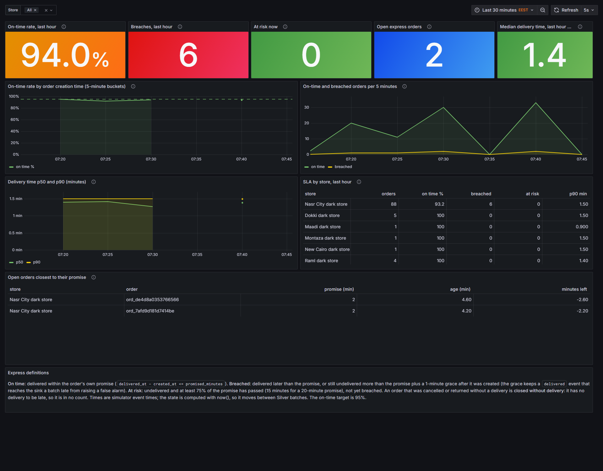

*بروفة 13 أكتوبر 2026 بوعد مقصّر لدقيقتين. الخط المتقطع في أول chart هو هدف الـ 95%.*

| Panel | بيعرض إيه وبيتحسب إزاي | إزاي تقراه |
|---|---|---|
| On-time rate, last hour (stat) | الـ orders on-time مقسومة على المتسلّمة أو الـ breached اللي اتعملت في آخر ساعة. | أحمر تحت 90%، برتقاني من 90 لـ 95%، أخضر من 95%. الـ screenshot بيعرض 94.0%، تحت الهدف بشوية، فهو برتقاني. |
| Breaches, last hour | orders اتسلّمت متأخر أو متأخرة (الوعد زائد دقيقة سماح). | أخضر عند 0، أحمر من 1. الـ screenshot بيعرض 6. |
| At risk now | orders غير متسلّمة استهلكت 75% من وعدها ولسه مش breached. | أخضر عند 0، برتقاني من 1، أحمر من 3. |
| Open express orders | اتعملت، ومش متسلّمة، ومش ملغية ولا مرتجعة، في آخر 3 ساعات. | أزرق، من غير حلو أو وحش. الطابور الحالي. |
| Median delivery time, last hour (min) | الـ p50 للـ orders المتسلّمة اللي اتعملت في آخر ساعة. | أخضر تحت 15 دقيقة، برتقاني لحد 20، أحمر فوق. نص الـ orders كانت أسرع من الرقم ده. |
| On-time rate by order creation time, 5-minute buckets (time series) | نسبة الـ orders المحسومة اللي اتسلّمت جوه وعدها، حسب وقت إنشاء الـ order، مع خط الهدف 95% المتقطع. | بيبيّن إمتى الخدمة وقعت. الـ buckets اللي مفيهاش orders فجوات مش 0%. |
| On-time and breached orders per 5 minutes | خطين: orders اتسلّمت on time وorders breached، حسب وقت الإنشاء. | بيبيّن الحجم ورا النسبة: النسبة الواطية على 2 orders معناها قليل، وعلى 30 معناها كتير. |
| Delivery time p50 and p90 (minutes) | الوسيط والـ 90th percentile لوقت تسليم الـ orders المتسلّمة حسب وقت الإنشاء. | قارن الخطين بالوعد. الـ p90 هو اللي أبطأ عُشر الـ customers حسّوا بيه. |
| SLA by store, last hour (table) | لكل dark store: orders، on-time rate، breaches، at risk، وp90 delivery time، الأسوأ الأول. | بيلاقي الـ store اللي بيفشل. في الـ screenshot مدينة نصر فيها 88 order و 6 breaches، والـ stores التانية مفيهاش. |
| Open orders closest to their promise (table) | orders غير متسلّمة، الأقدم الأول، مع الوعد والعمر والدقايق المتبقية. | "الدقايق المتبقية" السالبة معناها إن الـ order متأخر فعلًا. طارد دول الأول. |
| Express definitions (text) | on time و breached و at risk و closed without delivery. | بيعرّف كل رقم في الصفحة. |

### 2.4 FunnelStream: Live stock monitor (`fs-live-stock`)

**الغرض.** صحة الـ stock في الـ 8 dark stores، لحظيًا. فيه فلتر Store. Refresh كل 5 ثواني، آخر ساعة.

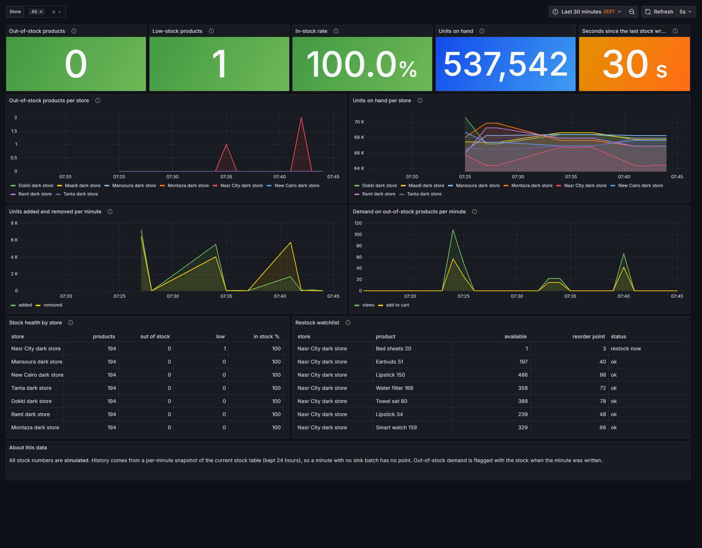

*بروفة 13 أكتوبر 2026. كل أرقام الـ stock محاكاة.*

| Panel | بيعرض إيه وبيتحسب إزاي | إزاي تقراه |
|---|---|---|
| Out-of-stock products (stat) | الأزواج اللي مفيهاش stock متاح في الـ stores المختارة. | أخضر عند 0، برتقاني من 1، أحمر من 5. |
| Low-stock products | stock فوق الصفر بس تحت الـ reorder point. | أخضر تحت 10، برتقاني من 10، أحمر من 30. |
| In-stock rate | نسبة الـ products المتتبّعة اللي ليها stock متاح. | أحمر تحت 90%، برتقاني من 90 لـ 97%، أخضر من 97% فما فوق. الـ screenshot بيعرض 100%. |
| Units on hand | إجمالي الوحدات المتاحة في الـ stores المختارة. | أزرق، مؤشر حجم. الـ screenshot بيعرض 537,542 وحدة. |
| Seconds since the last stock write | عمر أحدث صف stock، متأخر Silver batch تقريبًا. | أخضر تحت 30 ثانية، برتقاني لحد 60، أحمر فوق. |
| Out-of-stock products per store (time series) | أزواج الـ out-of-stock في كل دقيقة من الـ snapshots الدقيقة اللي بتتحفظ 24 ساعة. | بيبيّن إمتى وفين الـ stock-out بدأ وانتهى. الـ screenshot فيه spike-ين قصيرين في مدينة نصر. |
| Units on hand per store | الوحدات المتاحة لكل store في كل دقيقة. | بتنزل مع المبيعات وبتطلع مع إعادة التخزين. الخط اللي بينزل بس معناه مفيش restock. |
| Units added and removed per minute | التغيير في الوحدات المتاحة بين snapshots الدقايق: المضاف restock، والمخصوم مبيعات و shrinkage. | موجات الـ restock وضغط المبيعات جنب بعض. |
| Demand on out-of-stock products per minute | المشاهدات والـ add-to-carts على أزواج stock بتاعها صفر وقت كتابة الدقيقة. | الـ demand اللي الرف معرفش يخدمه. |
| Stock health by store (table) | لكل store: products متتبّعة، out of stock، low، نسبة in-stock والوحدات، الأسوأ الأول. | صف لكل dark store: مقارنة سريعة. |
| Restock watchlist (table) | الـ 20 زوج الأبعد تحت reorder point، مع حالة: out of stock أو restock now أو ok. | قايمة المهام لفريق الـ stock. في الـ screenshot "Bed sheets 20" في مدينة نصر فيها وحدة واحدة مقابل reorder point بـ 3. |
| About this data (text) | بيقول إن التاريخ جاي من snapshots دقيقة، فالدقيقة اللي مفيهاش sink batch مفيهاش نقطة. | بيفسّر الفجوات في الخطوط. |

### 2.5 FunnelStream: Inventory insights, daily (`fs-inventory-daily`)

**الغرض.** العرض اليومي للـ stock ووعد الـ express، مبني من الـ daily marts. Refresh كل دقيقة، آخر 14 يوم.

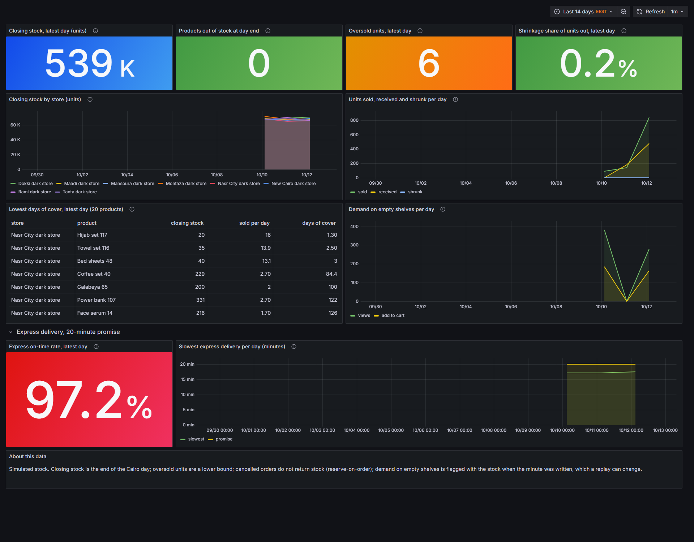

| Panel | بيعرض إيه وبيتحسب إزاي | إزاي تقراه |
|---|---|---|
| Closing stock, latest day (units) | الوحدات المتاحة في آخر يوم قاهرة في `inventory_daily`. | أزرق، مستوى. الـ stock محاكى ومش بينزل تحت الصفر. |
| Products out of stock at day end | أزواج store و product اللي stock بتاعها صفر أو أقل في آخر اليوم الأخير. | أخضر عند 0، برتقاني من 1، أحمر من 5. |
| Oversold units, latest day | وحدات اتطلبت أكتر من اللي على الرف. حد أدنى، لأن بيع صفر وحدات مبيطلّعش حركة. | أخضر عند 0، برتقاني من 1، أحمر من 20. معناها إن التطبيق وعد بـ stock مكانش عنده. |
| Shrinkage share of units out, latest day | الوحدات المفقودة (shrunk) مقسومة على المفقودة زائد المباعة. | أخضر تحت 3%، برتقاني من 3 لـ 6%، أحمر فوق 6%. الـ shrinkage هو stock ضاع من غير بيع. |
| Closing stock by store (units) | الـ stock في آخر كل يوم قاهرة، مجمّع لكل dark store. | اتجاه الـ stock لكل store على أسبوعين. |
| Units sold, received and shrunk per day | مجاميع الحركة اليومية على كل الـ stores والـ products، تلات خطوط. | قارن sold بـ received: لو المبيعات أكتر من المستلم، الـ stock بيستنزف. |
| Lowest days of cover, latest day, 20 products (table) | الـ closing stock مقسوم على متوسط الوحدات المباعة في اليوم في آخر 7 أيام. الـ products اللي مبتباعتش مستبعدة. | الرقم الواطي معناه إن الـ product هيخلص قريب بوتيرة البيع الحالية. |
| Demand on empty shelves per day | مشاهدات الـ product وadd-to-carts اللي وصلت والـ product out of stock، في اليوم. | الحجم اليومي للـ demand الضايع. |
| Express on-time rate, latest day | الـ orders on-time مقسومة على المتسلّمة أو الـ breached في آخر يوم في `express_daily`. بيعرض 100 لما مفيش حاجة تتقاس. | أحمر تحت 90%، برتقاني من 90 لـ 95%، أخضر من 95%. |
| Slowest express delivery per day (minutes) | أطول وقت تسليم في كل يوم قاهرة، مقابل خط ثابت عند وعد الـ 20 دقيقة. | النقطة فوق خط الوعد هي يوم فيه وعد اتفوّت. |
| About this data (text) | بيقول إن الـ stock محاكى، والـ oversold units حد أدنى، والـ orders الملغية مبترجّعش stock. | حدود الأرقام اللي فوق. |

### 2.6 FunnelStream: Marketing, D-1 (`fs-marketing-d1`)

**الغرض.** نتايج الـ campaigns بتاعة امبارح جنب الـ spend المقدّر اللي راح لـ products out of stock. Refresh كل دقيقة، آخر 14 يوم. بيقرا الـ marts `marketing_d1_campaign` و `marketing_d1_product`.

**ببساطة:** D-1 يعني "امبارح". الصفحة دي بتقول: امبارح صرفنا كام على الإعلانات، وكام منه راح لمنتجات خالصة.

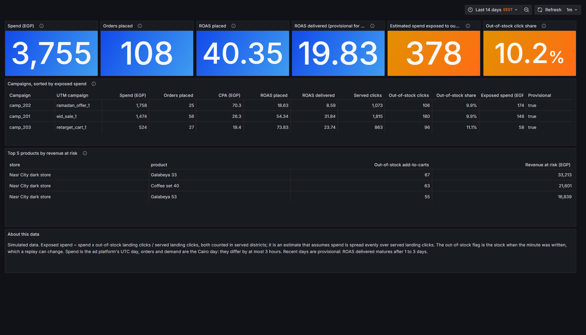

| Panel | بيعرض إيه وبيتحسب إزاي | إزاي تقراه |
|---|---|---|
| Spend (EGP) | Ad spend لآخر يوم D-1، كل الـ campaigns. ده يوم القاهرة. | أزرق، الـ budget المستخدم. |
| Orders placed | الـ orders المنسوبة للـ campaigns بـ last touch في آخر يوم D-1. | أزرق. |
| ROAS placed | الـ placed revenue مقسوم على الـ spend. | أزرق. هو العائد المتفائل، لأن الـ orders الملغية والفاشلة لسه معدودة. |
| ROAS delivered (provisional) | الـ delivered revenue مقسوم على الـ spend. | أزرق. العائد الأساسي. التسليم بينضج بعد يوم لتلات أيام من يوم الـ order، فالأيام الأخيرة بتقرا واطية. |
| Exposed spend (EGP) | الـ spend مضروب في نسبة landing clicks اللي راحت لـ products out of stock. | أخضر عند 0، برتقاني من 1، أحمر من 1,000. تقدير بيفترض إن الـ spend موزّع بالتساوي على landing clicks اللي اتخدمت. |
| Out-of-stock click share | landing clicks في الدقايق المعلّمة out of stock، مقسومة على كل landing clicks في الـ districts المخدومة. | أخضر تحت 5%، برتقاني من 5 لـ 15%، أحمر من 15%. |
| Campaigns, sorted by exposed spend (table) | صف لكل campaign بـ spend و orders و CPA و ROAS placed و delivered و clicks اللي اتخدمت و out-of-stock و click share و exposed spend وعلامة provisional. | أنهي campaign بعتت أكتر shoppers لرفوف فاضية. الأيام الـ provisional لسه ممكن تتغيّر. |
| Top 5 products by revenue at risk (table) | add-to-carts الـ out-of-stock مضروبة في السعر، لكل store و product، في آخر يوم D-1. | أنهي products تعيد تخزينها الأول، أو توقف إعلانها. الـ mart بيحتفظ بكل product out of stock. حد الخمسة ده بتاع الـ panel. |
| About this data (text) | بيعرّف exposed spend وبيذكر يوم القاهرة والأيام الـ provisional. | اقراه قبل ما تقتبس الـ exposed spend. |

### 2.7 الـ 8 alert rules

الـ alerts بتبلّغ لما الحالة تتغيّر، على alert sink محلي.

| القاعدة | بتشتغل إمتى | معناها إيه |
|---|---|---|
| Late-event rate above 5% | الـ late events أكتر من 5% في 5 دقايق، مع 20 event على الأقل. | فرق ساعة أو events قديمة اتعمللها replay. |
| Quarantine share above 2% | الصفوف المحجوزة أكتر من 2% في 5 دقايق، مع 20 صف على الأقل. | producer بيبعت بيانات وحشة. |
| Silver job silent for 2 minutes | الـ Silver heartbeat أقدم من دقيقتين (مفيش بيانات بتشغّله برضه). | الـ streaming job واقع أو عالق. |
| No events for 5 minutes | مفيش Silver event وصل في آخر 5 دقايق (مفيش بيانات بتشغّله برضه). | الـ producers أو الـ job وقفوا. |
| Demand on out-of-stock products | 5 add-to-carts على الأقل على product out of stock في store واحد في كل دقيقتين ورا بعض. | shoppers بيخبطوا في رف فاضي. |
| An express order missed its delivery promise | أي breach. | customer استنّى أكتر من الوعد. |
| Express on-time rate below the 95% target | on-time rate تحت 95% في 30 دقيقة مع 5 orders على الأقل، لمدة دقيقتين. | مستوى الخدمة بينزل. |
| Many products out of stock in one store | أكتر من 20% من products الـ store out of stock، لمدة دقيقة. | dark store واحد بيفضى. |

---

## 3. Power BI

التقرير فيه 7 صفحات. في كل صفحة، الـ rail الكحلي على الشمال فيه الـ page navigator والـ slicers. الـ banner بيقول السؤال اللي الصفحة بتجاوب عليه. صف الـ cards بيعرض الأرقام الرئيسية، والـ charts والجداول تحته بتشرحها. الـ slicers بتفلتر الصفحة كلها.

تعريفات الـ measures في `dashboards/powerbi/measures.dax`. تلات قواعد على الكل: النسب بتتحسب كنسبة مجاميع (مش متوسط نسب أبدًا)، والشريحة الفاضية بتعرض blank مش error، وكل بيانات الـ stock محاكاة.

### 3.1 Executive: الـ revenue ماشي صح؟ والـ orders بتتسرّب فين؟

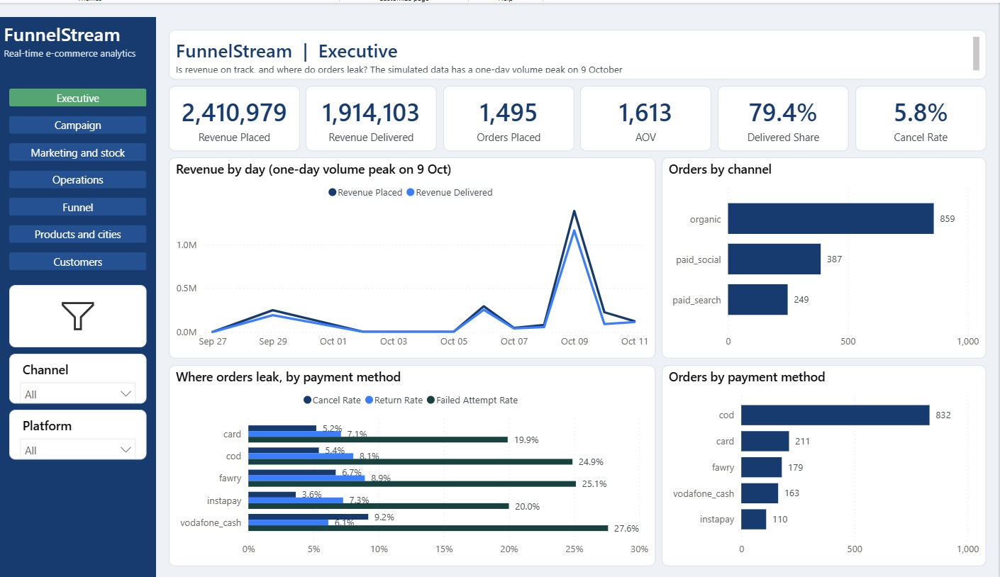

**Slicers:** الفترة، الـ channel، الـ platform.

| Visual | بيعرض إيه وبيتحسب إزاي | إزاي تقراه |
|---|---|---|
| Card: Revenue Placed | مجموع revenue كل الـ orders المتسجّلة، منسوبة أو لأ (`Orders Daily`). | إجمالي قيمة المبيعات. الـ screenshot بيعرض 2,410,979. |
| Card: Revenue Delivered | revenue الـ orders اللي اتسلّمت، معدودة على تاريخ الـ order (cohort view). | الكاش اللي دخل فعلًا. 1,914,103 في الـ screenshot. |
| Card: Orders Placed | عدد الـ orders المتسجّلة. | 1,495. |
| Card: AOV | Average order value: revenue placed مقسوم على orders placed. | 1,613. |
| Card: Delivered Share | revenue delivered مقسوم على revenue placed. | نسبة المبيعات اللي بقت كاش: 79.4%. |
| Card: Cancel Rate | الـ orders الملغية مقسومة على الـ placed. | 5.8%. |
| Line chart: Revenue by day | خطين: revenue placed و revenue delivered، حسب اليوم. | بيبيّن الاتجاه والفجوة بين placed و delivered. يوم واحد، 9 أكتوبر، فيه حوالي 55% من كل الـ revenue في البيانات المحاكاة، والعنوان بيقول كده. |
| Bar chart: Orders by channel | الـ placed orders لكل channel، مترتّبة. | أنهي channel بيجيب orders: organic 859، paid social 387، paid search 249. |
| Bar chart: Where orders leak, by payment method | تلات أعمدة لكل payment method: cancel rate و return rate و failed-attempt rate، كلها على الـ placed orders. | فين الـ orders بتضيع. الـ failed-attempt rate الأعلى عند vodafone_cash (27.6%) و fawry (25.1%). |
| Bar chart: Orders by payment method | الـ placed orders لكل payment method، مترتّبة. | الكاش عند الاستلام هو الأكبر، 832 order. اقراه جنب chart التسرّب. |

### 3.2 Campaigns: الـ budget الجاي يروح فين؟

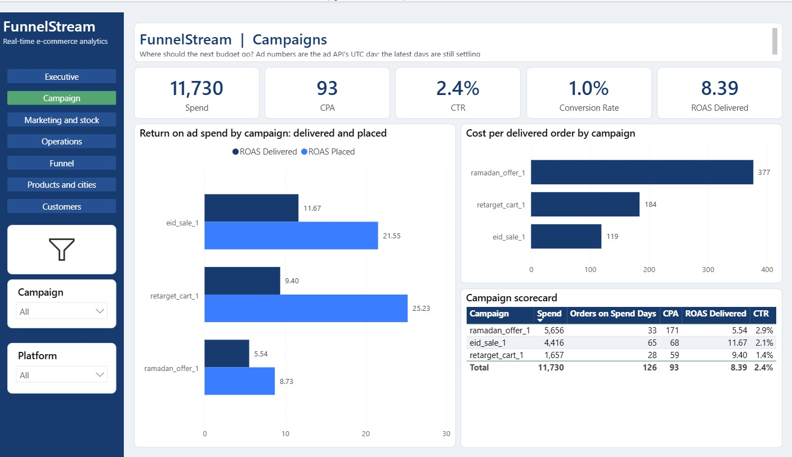

**Slicers:** الفترة، الـ campaign، الـ platform.

| Visual | بيعرض إيه وبيتحسب إزاي | إزاي تقراه |
|---|---|---|
| Card: Spend | مجموع ad spend من الـ ad API. | 11,730. أيام الإعلانات هي أيام القاهرة. |
| Card: CPA | Cost per acquisition: الـ spend مقسوم على الـ placed orders المنسوبة في الأيام اللي فيها spend. | 93. placed orders بس. |
| Card: CTR | Click-through rate: الـ clicks اللي بلّغ عنها الـ API مقسومة على impressions. | 2.4%. دي عدّ المنصة للـ clicks، مش الـ click المستخدم في الـ attribution. |
| Card: Conversion Rate | الـ orders المنسوبة مقسومة على clicks الـ API. | 1.0%. |
| Card: ROAS Delivered | Return on ad spend: الـ delivered revenue في أيام الـ spend مقسوم على الـ spend. | الرقم الأساسي، 8.39. هو اللي الكاش بيرجّعه فعلًا. |
| Bar chart: Return on ad spend by campaign | عمودين لكل campaign: ROAS delivered و ROAS placed، مترتّبة بالـ delivered. | الفجوة بين العمودين هي الـ revenue اللي ضاع بسبب الـ orders الملغية والمرتجعة والفاشلة في الكاش عند الاستلام. لـ eid_sale_1 هو 11.67 delivered مقابل 21.55 placed. |
| Bar chart: Cost per delivered order by campaign | الـ spend مقسوم على الـ delivered orders، لكل campaign. | الأقل أحسن. ramadan_offer_1 بـ 377، retarget_cart_1 بـ 184، eid_sale_1 بـ 119. |
| Table: Campaign scorecard | لكل campaign: spend، orders في أيام الـ spend، CPA، ROAS delivered، CTR، مع صف إجمالي. | الملخص اللي بنقارن بيه الـ campaigns. الصف الإجمالي بيطابق الـ cards. الـ CPA في الـ scorecard (171 لـ ramadan_offer_1) بيختلف عن cost per delivered order (377) بالتعريف. |

**ملاحظة قراءة.** الـ ROAS نسبة فترة. اقراه على أسبوع أو على فترة campaign، مش كحقيقة يومية. الأيام الأخيرة لسه settling لأن الـ delivered revenue بيتأخر عن الـ spend بحوالي يومين لأربعة.

### 3.3 Marketing and stock: أنهي campaign بعتت shoppers لرفوف فاضية؟

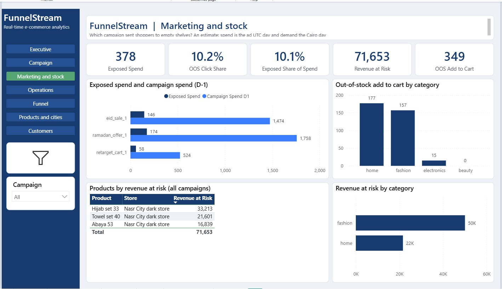

**Slicers:** الفترة، الـ campaign. الصفحة دي بتقرا الـ D-1 marketing marts.

| Visual | بيعرض إيه وبيتحسب إزاي | إزاي تقراه |
|---|---|---|
| Card: Exposed Spend | مجموع الـ exposed spend لكل campaign ويوم: spend مضروب في out-of-stock clicks على served clicks. | تقدير للـ spend اللي وصل لـ products out of stock. 378 في الـ screenshot. |
| Card: OOS Click Share | landing clicks الـ out-of-stock مقسومة على landing clicks المخدومة. | 10.2% من الـ clicks قابلت رف فاضي. |
| Card: Exposed Share of Spend | الـ exposed spend مقسوم على spend الـ campaign. | 10.1% من الـ spend. |
| Card: Revenue at Risk | add-to-carts على products out of stock مضروبة في السعر. | 71,653. revenue الرف معرفش يخدمه، مش revenue ضايع. |
| Card: OOS Add to Cart | عدد events الـ add-to-cart على products out of stock. | 349. |
| Bar chart: Exposed spend and campaign spend (D-1) | عمودين لكل campaign: exposed spend وإجمالي spend اليوم ده. | عمود الـ exposed جزء صغير من عمود الـ spend. قارن الـ campaigns: ramadan_offer_1 فيها 174 exposed من 1,758 spend. |
| Column chart: Out-of-stock add to cart by category | add-to-carts على الرفوف الفاضية لكل category. | أنهي category بتخسّر shoppers: home 177 و fashion 157. |
| Table: Products by revenue at risk (all campaigns) | الـ product والـ store والـ revenue at risk، مترتّبة بالـ revenue at risk. | قايمة الـ products اللي تعيد تخزينها أو توقف إعلانها. في الـ screenshot التلاتة في dark store مدينة نصر. |
| Bar chart: Revenue at risk by category | الـ revenue at risk لكل category. | عرض الفلوس لـ chart الـ category: fashion حوالي 50K و home 22K. |

**ملاحظة قراءة.** الصفحة دي تقدير. الـ spend والـ orders والـ demand كلها بيوم القاهرة. وعلامة الـ out-of-stock هي الـ stock وقت ما الدقيقة اتكتبت.

### 3.4 Operations: نعيد تخزين إيه؟ ووعد الـ 20 دقيقة ماشي؟

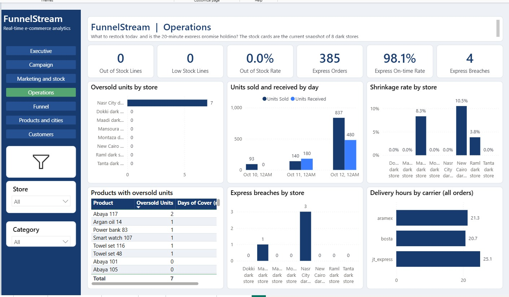

**Slicers:** الفترة، الـ store، الـ product category.

| Visual | بيعرض إيه وبيتحسب إزاي | إزاي تقراه |
|---|---|---|
| Card: Out of Stock Lines | أزواج store و product اللي stock المتاح صفر أو أقل، في الـ snapshot الحالي للـ 8 dark stores. | 0 في الـ screenshot. مش متفلتر بالتاريخ. |
| Card: Low Stock Lines | الأزواج فوق الصفر وتحت reorder point. | 0. |
| Card: Out of Stock Rate | الـ out-of-stock lines مقسومة على كل stock lines. | 0.0%. |
| Card: Express Orders | عدد الـ express orders في الفترة. | 385. |
| Card: Express On-time Rate | الـ orders on-time مقسومة على on-time زائد breached. | 98.1%. الهدف 95%. |
| Card: Express Breaches | orders اتسلّمت بعد وعدها أو مش متسلّمة بعد الوعد زائد دقيقة. دايمًا رقم، الصفر بيظهر 0. | 4. |
| Bar chart: Oversold units by store | الوحدات اللي الـ customers طلبوها أكتر من الـ stock على الرف، لكل store. | التطبيق وعد بـ stock مكانش عنده. الـ 7 وحدات كلها في مدينة نصر. حد أدنى. |
| Column chart: Units sold and received by day | عمودين لكل يوم: الوحدات المباعة والوحدات المستلمة. | الـ stock بيستنزف لما sold يعدّي received. |
| Column chart: Shrinkage rate by store | الوحدات المفقودة مقسومة على المباعة زائد المفقودة، لكل store. | stock ضاع من غير بيع. New Cairo الأعلى بـ 10.5% في الـ screenshot. |
| Table: Products with oversold units | الـ product والـ oversold units والـ days of cover، مترتّبة بالـ oversold units. | الـ products ورا chart الـ oversold. الـ days of cover هي closing stock على متوسط المبيعات اليومية، بحد أقصى 90. |
| Column chart: Express breaches by store | الـ breaches لكل dark store. | أنهي store فوّت الوعد: مدينة نصر فيها 3. |
| Bar chart: Delivery hours by carrier (all orders) | متوسط الساعات من الـ order للتسليم، لكل carrier، على الـ orders المتسلّمة اللي وقت تسليمها معروف. | توصيل عادي، مش express: aramex 21.3 و bosta 20.7 و jt_express 25.1 ساعة. |

### 3.5 Funnel: أنهي خطوة وأنهي channel نصلّحها الأول؟

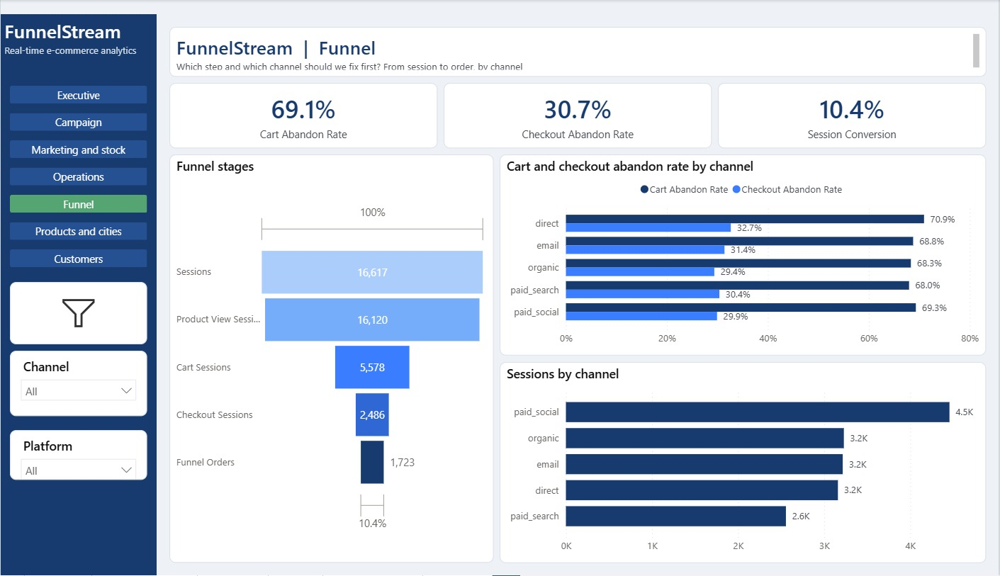

**Slicers:** الفترة، الـ channel، الـ platform.

**ببساطة:** الـ funnel هو "قمع" شكله واسع من فوق وضيّق من تحت: ناس كتير بتدخل، وقليلين بيشتروا. السؤال: الناس بتقع فين؟

| Visual | بيعرض إيه وبيتحسب إزاي | إزاي تقراه |
|---|---|---|
| Card: Cart Abandon Rate | `1 - orders / cart sessions`، blank للشريحة الفاضية، محصورة بين 0 و 1. | من الـ sessions اللي ضافت للـ cart، كام منها مطلبتش order. 69.1%. |
| Card: Checkout Abandon Rate | `1 - orders / checkout sessions`، blank للشريحة الفاضية، محصورة بين 0 و 1. | من الـ sessions اللي بدأت checkout، كام منها مطلبتش order. 30.7%. |
| Card: Session Conversion | الـ funnel orders مقسومة على sessions. | 10.4%. |
| Funnel: Funnel stages | 5 مراحل: sessions، product-view sessions، cart sessions، checkout sessions، orders. | العرض بيبيّن كام واحد بيعدّي كل خطوة. Sessions 16,617، product views 16,120، cart 5,578، checkout 2,486، orders 1,723. أكبر نزول بين product view و cart. |
| Bar chart: Cart and checkout abandon rate by channel | عمودين لكل channel. | أنهي channel بيخسّر أكتر shoppers. Direct أعلى cart abandon rate، 70.9%. الـ channels قريبين من بعض. |
| Bar chart: Sessions by channel | الـ sessions لكل channel، مترتّبة. | حجم كل channel. Paid social بيجيب الأكتر، 4.5K. |

**ملاحظة قراءة.** الـ sessions بتتعدّ حسب يوم القاهرة، فالـ session اللي بتعدّي نص الليل بتتعدّ مرة في كل يوم. الـ sessions اليومية مبتجمعش بالظبط على الأيام.

### 3.6 Products and cities: نخزّن ونروّج لإيه، وفين؟

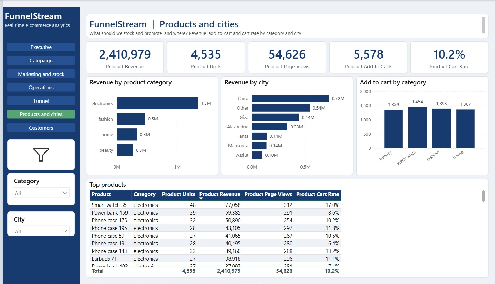

**Slicers:** الفترة، الـ product category، الـ city.

| Visual | بيعرض إيه وبيتحسب إزاي | إزاي تقراه |
|---|---|---|
| Card: Product Revenue | مجموع الـ revenue حسب city و product ويوم (`agg_city_product_daily`). | 2,410,979، نفس placed revenue في صفحة Executive. |
| Card: Product Units | الوحدات المباعة. | 4,535. |
| Card: Product Page Views | الـ sessions اللي شافت product، مجموعة لكل city و product ويوم. | 54,626. الـ session اللي بتشوف 3 products بتتعدّ 3 مرات، فهو أكبر من sessions الـ funnel. |
| Card: Product Add to Carts | الـ sessions اللي ضافت product للـ cart. | 5,578. |
| Card: Product Cart Rate | الـ add-to-carts مقسومة على product page views. | 10.2%. |
| Bar chart: Revenue by product category | الـ revenue لكل category، مترتّبة. | Electronics بتكسب حوالي 1.3M، أكتر بكتير من fashion و home و beauty. |
| Bar chart: Revenue by city | الـ revenue لكل city، مترتّبة. | Cairo في المقدمة بـ 0.72M، بعدها Other وGiza وAlexandria. |
| Column chart: Add to cart by category | الـ add-to-carts لكل category. | شبه متساوية بين الـ categories (1,359 لـ 1,454)، فـ electronics بتكسب أكتر لكل cart، مش carts أكتر. |
| Table: Top products | الـ product والـ category والوحدات والـ revenue والـ page views والـ cart rate، مترتّبة بالـ revenue. | الأكتر مبيعًا وقد إيه كل واحد بيتحوّل من مشاهدة لـ cart. |

### 3.7 Customers: مين بيشتري تاني، ومين نرجّعه؟

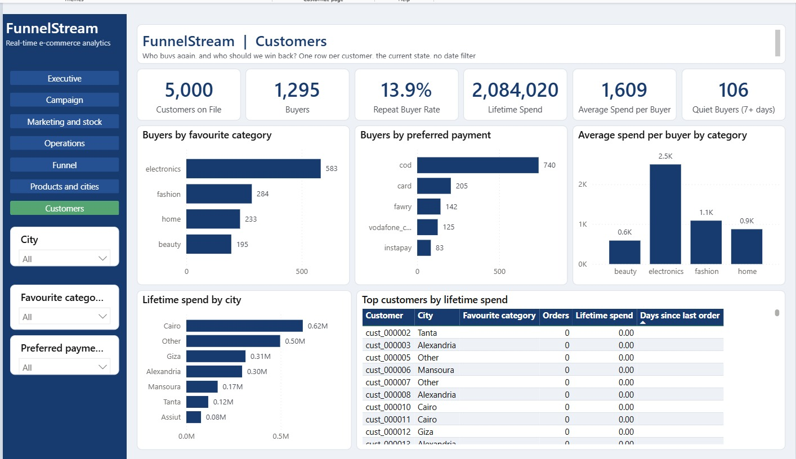

**Slicers:** الـ city، الـ favourite category، الـ preferred payment method. الصفحة دي مفيهاش فلتر تاريخ: بتعرض صف لكل customer، في حالته الحالية.

| Visual | بيعرض إيه وبيتحسب إزاي | إزاي تقراه |
|---|---|---|
| Card: Customers on File | الـ customers المميزين في `customer_360`. | 5,000. |
| Card: Buyers | الـ customers اللي عندهم order متسجّل واحد على الأقل. | 1,295. |
| Card: Repeat Buyer Rate | الـ customers اللي عندهم orderين أو أكتر مقسومين على buyers. | 13.9%. |
| Card: Lifetime Spend | إنفاق الـ orders اللي مش ملغية ولا مرتجعة، بالجنيه. | 2,084,020. |
| Card: Average Spend per Buyer | الـ lifetime spend مقسوم على buyers. | 1,609. |
| Card: Quiet Buyers (7+ days) | buyers آخر order ليهم عمره 7 أيام أو أكتر. | 106. البيانات بتغطي حوالي 15 يوم، فقاعدة 30 يوم كانت هتبقى فاضية دايمًا. |
| Bar chart: Buyers by favourite category | الـ buyers لكل category، مترتّبة. | Electronics فيها الأكتر، 583. |
| Bar chart: Buyers by preferred payment | الـ buyers لكل payment method مفضّلة، مترتّبة. | الكاش عند الاستلام في المقدمة بـ 740. |
| Column chart: Average spend per buyer by category | الـ lifetime spend على buyers، لكل favourite category. | buyers الـ electronics بيصرفوا الأكتر، حوالي 2.5K. القياس per-buyer بيتجنّب عمود "(Blank)" مضلّل للـ customers اللي مطلبوش أبدًا. |
| Bar chart: Lifetime spend by city | الـ lifetime spend لكل city، مترتّبة. | Cairo في المقدمة بـ 0.62M. |
| Table: Top customers by lifetime spend | الـ customer id والـ city والـ favourite category والـ orders والـ lifetime spend وأيام من آخر order. | المفروض يعرض أعلى الـ spenders الأول. **اتأكد على الشاشة:** في الـ screenshot الجدول مترتّب بأيام من آخر order، فالـ customers اللي عندهم 0 orders ظاهرين الأول، مش أعلى الـ spenders. لو شفت كده، اضغط على header "Lifetime spend" لحد ما أكبر القيم تيجي الأول. التقرير فيه الـ customer id بس، مفيهوش أسماء أو أرقام تليفونات. |

---

## 4. قاموس الـ measures المستخدمة في الصفحات

| المصطلح | معناه |
|---|---|
| ROAS | Return on ad spend: الـ revenue مقسوم على الـ spend. "Delivered" بيعدّ revenue الـ orders المتسلّمة بس، و"placed" بيعدّ كل الـ orders المتسجّلة. |
| CPA | الـ spend مقسوم على الـ placed orders. |
| Cost per delivered order | الـ spend مقسوم على الـ delivered orders بس. |
| CTR | الـ clicks مقسومة على impressions، زي ما بلّغ الـ ad API. |
| AOV | Average order value، الـ placed revenue مقسوم على الـ placed orders. |
| Delivered share | الـ delivered revenue مقسوم على الـ placed revenue. |
| Cancel, return, failed-attempt rate | الـ orders الملغية أو المرتجعة أو اللي فيها محاولة تسليم فاشلة على الأقل، على الـ placed orders. |
| Funnel stages | Sessions و product views و cart و checkout و order. الـ abandon rate هو واحد ناقص الخطوة اللي بعدها على اللي قبلها. |
| Out of stock | product فيه `available <= 0` في store. الـ low stock فوق الصفر وتحت reorder point. |
| Oversold units | الوحدات اللي الـ customers طلبوها أكتر من الـ stock على الرف. حد أدنى. |
| Shrinkage | وحدات ضاعت من غير بيع. النسبة هي shrunk على sold زائد shrunk. |
| Days of cover | الـ closing stock مقسوم على متوسط الوحدات المباعة في اليوم، بحد أقصى 90. |
| Express on time, breached, at risk | On time: اتسلّم جوه وعد الـ order نفسه. Breached: اتسلّم متأخر، أو مش متسلّم بعد الوعد زائد دقيقة. At risk: مش متسلّم واستهلك 75% من الوعد على الأقل. |
| Exposed spend | الـ spend مضروب في نسبة landing clicks اللي راحت لـ products out of stock. تقدير. |
| Revenue at risk | add-to-carts على products out of stock مضروبة في السعر. مش revenue ضايع. |
| Provisional أو "Settling" | يوم حديث الـ delivered revenue بتاعه لسه ممكن يزيد، فالـ ROAS delivered بيقرا واطي. |
| Late event | event بيوصل Kafka بعد أكتر من 10 دقايق من وقته. |
| Quarantine | جدول الصفوف اللي الـ validator رفضها، كل واحد مع error code. |
