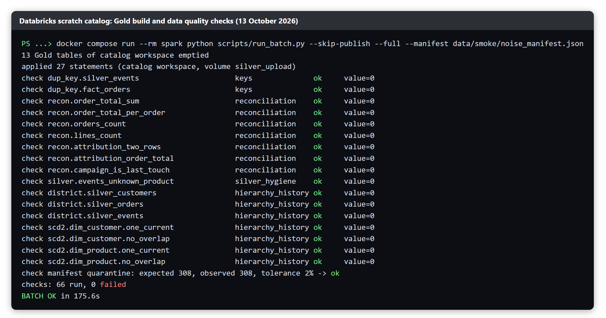

# FunnelStream data quality checks: all 66, explained

This document explains every check that the Gold build runs. The definitions are in `warehouse/checks.py`. The results quoted at the end come from the Gold build on the scratch catalog on 13 October 2026.

---

## 1. How the checks work

The checks are the last step of the Gold build (`scripts/run_batch.py`). After Databricks has built the Gold tables from the Silver mirror, the build runs every check as one read-only SQL statement that returns one number.

- A check of severity **fail** returns a violation count. Any value other than zero fails the batch.
- A check of severity **report** returns a number that is printed and never fails the batch. It is there for a person to read.
- A check that cannot run (a broken query, an unreadable manifest) is a technical error and stops the build. A check that runs and finds a violation does not raise an error: the whole list stays visible in the result.
- The SQL is written in Python, uses only three placeholders (`{silver}`, `{gold}` and the allowed city and district pairs), contains one statement and no write keyword. A test (`tests/test_checks.py`) checks every query against these rules.

**Why 66.** The list in `warehouse/checks.py` holds 64 checks. The manifest comparison adds two more entries, so a run with `--manifest` reports 66. A run without the manifest reports 65, because the manifest check is then one "skipped" entry.

| Group | Checks | Severity | Question it answers |
|---|---|---|---|
| Keys | 25 | 24 fail, 1 report | Is every row unique, and does every foreign key point at a real row? |
| Reconciliation | 7 | fail | Do Gold and Silver agree, and do the money totals add up? |
| Silver hygiene | 7 | fail | Did anything slip past the Silver validator? |
| Hierarchy and history | 7 | fail | Are districts inside their city, and are the slowly changing dimensions consistent? |
| Reported | 18 | report | What are the rates and row counts of this run? |
| Manifest | 2 | 1 fail, 1 report | Did the pipeline catch the noise the simulator injected? |
| **Total** | **66** | **46 fail, 20 report** | |

**What this means in practice.** Forty-six checks can stop a batch. Twenty are measurements for a person to read, and they never fail. When we say "66 checks, 0 failed", it means none of the 46 fail-type checks found a violation, and the other 20 produced their numbers.

**Thresholds used by the checks**

| Setting | Value | Used by |
|---|---|---|
| Future tolerance | 5 minutes (the clock skew the Silver validator allows) | Check 34 |
| Line total tolerance | 0.01 EGP (rounding) | Check 37 |
| Open order age | 14 days | Check 51 |
| Manifest tolerance | 2% of the expected quarantine count | Check 65 |

---

## 2. Group 1: Keys (checks 1 to 25)

A key check protects every number downstream. If one order appeared twice, every revenue and order count that includes it would be too high.

### 2.1 Duplicate keys, Silver mirror (checks 1 to 7)

Each check groups the table by its key and counts key values that appear in more than one row. The expected value is 0.

| # | Check | Key | Why it matters |
|---|---|---|---|
| 1 | `dup_key.silver_events` | `event_id` | Two rows for one event would double count sessions, views and carts. This is the check on the deduplication of the 1% duplicate events. |
| 2 | `dup_key.silver_orders` | `order_id` | One order must be one row. |
| 3 | `dup_key.silver_order_status` | `event_id` | One row per status change event. |
| 4 | `dup_key.silver_order_items` | `order_id`, `line_no` | One row per order line. A duplicate line inflates revenue. |
| 5 | `dup_key.silver_products` | `product_id`, `updated_at` | One row per product version. |
| 6 | `dup_key.silver_customers` | `customer_id`, `updated_at` | One row per customer version. |
| 7 | `dup_key.silver_campaign_snapshots` | `campaign_id`, `report_date`, `pulled_at` | One row per campaign per day per pull. A repeated pull of the ad API must not repeat rows. |

### 2.2 Duplicate keys, Gold tables (checks 8 to 19)

The same check on the twelve Gold tables. The expected value is 0.

| # | Check | Key | Why it matters |
|---|---|---|---|
| 8 | `dup_key.dim_customer` | `customer_key` | A repeated surrogate key makes every fact row join twice. |
| 9 | `dup_key.dim_product` | `product_key` | Same. |
| 10 | `dup_key.dim_campaign` | `campaign_key` | Same. |
| 11 | `dup_key.dim_date` | `date_key` | Same. |
| 12 | `dup_key.fact_orders` | `order_id` | One row per order in the fact table. |
| 13 | `dup_key.fact_order_lines` | `order_id`, `line_no` | One row per order line. |
| 14 | `dup_key.fact_attribution` | `order_id`, `model` | One row per order and attribution model (last touch, first touch). |
| 15 | `dup_key.agg_orders_daily` | `date_key`, `channel`, `payment_method`, `platform` | Each daily bucket exists once, so the Executive page does not double count. |
| 16 | `dup_key.agg_funnel_daily` | `event_date`, `country`, `channel`, `platform` | Each funnel bucket exists once. |
| 17 | `dup_key.agg_campaign_daily` | `campaign_id`, `report_date`, `attribution_model` | Each campaign day and model exists once, so spend is not counted twice. |
| 18 | `dup_key.agg_city_product_daily` | `city`, `product_id`, `date_key` | Each city and product day exists once. |
| 19 | `dup_key.customer_360` | `customer_id` | One row per customer. |

### 2.3 Orphan keys (checks 20 to 24)

An orphan is a fact row that points at a dimension row or a parent row that does not exist. The key `-1` is the allowed "unknown member": a row is not an orphan if it points at `-1`. A NULL key is always a violation, because the build should have written `-1` instead.

| # | Check | What it counts | Why it matters |
|---|---|---|---|
| 20 | `orphan.fact_orders.customer_key` | `fact_orders` rows whose `customer_key` is NULL or not in `dim_customer` | Orders must belong to a known customer or to the unknown member, or customer reports lose revenue. |
| 21 | `orphan.fact_order_lines.customer_key` | `fact_order_lines` rows with the same problem | Same, for order lines. |
| 22 | `orphan.fact_order_lines.product_key` | `fact_order_lines` rows whose `product_key` is NULL or not in `dim_product` | Product revenue must always find a product. |
| 23 | `orphan.fact_order_lines.order_id` | order lines whose order is not in `fact_orders` | A line without an order would add revenue with no order. |
| 24 | `orphan.fact_attribution.order_id` | attribution rows whose order is not in `fact_orders` | Attribution must describe real orders. |

### 2.4 Report: unknown customer share (check 25)

`unknown_customer_share` is the share of `fact_orders` rows with the unknown customer key `-1`, from 0 to 1. It is a report-type check. A high value would mean many orders could not be matched to a customer version valid at the order time.

---

## 3. Group 2: Reconciliation (checks 26 to 32)

Reconciliation checks compare one table with another that should agree. They catch a build that silently loses or invents rows or money.

| # | Check | What it tests | Why it matters |
|---|---|---|---|
| 26 | `recon.order_total_sum` | 1 if the sum of `fact_orders.order_total` differs from the sum of `fact_order_lines.line_total`, else 0 | The fast, whole-database money check: order revenue must equal line revenue. |
| 27 | `recon.order_total_per_order` | Orders whose `order_total` differs from the sum of their lines (no lines counts as 0) | Finds the exact orders behind a failure of check 26. |
| 28 | `recon.orders_count` | The difference between the rows of `fact_orders` and the distinct `silver_orders` that have a created time and a status row | Gold must contain every order the build is meant to include, no more and no fewer. |
| 29 | `recon.lines_count` | The difference between `fact_order_lines` rows and the `silver_order_items` rows whose order is in `fact_orders` | No order line may be lost or invented between Silver and Gold. |
| 30 | `recon.attribution_two_rows` | Orders that do not have exactly one `last_touch` row and one `first_touch` row | Both attribution models must cover every order, so their totals can be compared. |
| 31 | `recon.attribution_order_total` | Attribution rows whose `order_total` differs from `fact_orders.order_total` | Revenue attributed to campaigns must equal revenue of the orders. |
| 32 | `recon.campaign_is_last_touch` | Orders whose `fact_orders.campaign_id` differs from the last-touch campaign of that order | The campaign shown on the order must be the last-touch campaign, so reports agree with each other. |

---

## 4. Group 3: Silver hygiene (checks 33 to 39)

These checks look at the Silver mirror and ask whether any bad row passed the validator. In theory all of them return 0, because the validator quarantines bad rows. A non-zero value means a validator rule is missing or broken.

| # | Check | What it counts | Why it matters |
|---|---|---|---|
| 33 | `silver.events_null_key_or_time` | `silver_events` rows with a NULL `event_id` or `event_time` | An event without an id cannot be deduplicated, and without a time it cannot be placed on a day. |
| 34 | `silver.events_future_time` | Events more than 5 minutes in the future | The validator tolerates 5 minutes of clock skew and quarantines anything later (`FUTURE_TIMESTAMP`). A hit means that rule failed. |
| 35 | `silver.events_unknown_product` | Events with a `product_id` that is not in `silver_products` (NULL is allowed) | An unknown product is quarantined (`UNKNOWN_PRODUCT`). A hit would break product reports. |
| 36 | `silver.order_status_not_allowed` | Status rows whose status is not one of the statuses of the Silver contract | A misspelt status would break the order lifecycle ranking. |
| 37 | `silver.order_items_line_total` | Order lines where `line_total` differs from `quantity x unit_price` by more than 0.01 | The price arithmetic must hold. The 0.01 EGP margin allows for rounding. |
| 38 | `silver.snapshots_clicks_gt_impressions` | Ad snapshots with more clicks than impressions | Impossible data. The ad report validator rejects it (`CLICKS_GT_IMPRESSIONS`). |
| 39 | `silver.snapshots_negative_spend` | Ad snapshots with negative spend | Impossible data. The validator rejects it (`NEGATIVE_SPEND`). |

---

## 5. Group 4: Hierarchy and history (checks 40 to 46)

### 5.1 District inside city (checks 40 to 42)

Each check counts rows whose district is not one of the districts of their city. The allowed pairs come from the same file as the simulator (`contracts/geo.py`). A blank district, `unknown`, and an unknown city are not violations.

| # | Check | Table | Why it matters |
|---|---|---|---|
| 40 | `district.silver_customers` | `silver_customers` | A customer in "Maadi, Alexandria" would be a data error. Store assignment depends on the district. |
| 41 | `district.silver_orders` | `silver_orders` | The delivery address of an order must be consistent. |
| 42 | `district.silver_events` | `silver_events` | Demand and out-of-stock analysis use the district to pick the store. |

### 5.2 Slowly changing dimensions (checks 43 to 46)

`dim_customer` and `dim_product` keep history. Each change writes a new version with `valid_from`, `valid_to` and `is_current`. Two things must always hold.

| # | Check | What it counts | Why it matters |
|---|---|---|---|
| 43 | `scd2.dim_customer.one_current` | Customers that do not have exactly one `is_current` row | Zero current rows means the customer vanished from current reports. Two means the customer is counted twice. |
| 44 | `scd2.dim_customer.no_overlap` | Pairs of versions of the same customer whose validity ranges overlap | At any moment a customer has one version, so a fact finds one dimension row. |
| 45 | `scd2.dim_product.one_current` | Products that do not have exactly one `is_current` row | Same, for products. |
| 46 | `scd2.dim_product.no_overlap` | Pairs of product versions whose validity ranges overlap | Same. A price change must not leave two valid prices at one time. |

---

## 6. Group 5: Reported (checks 47 to 64)

These are report-type checks. They never fail the batch. A person reads them to judge the run.

### 6.1 Rates and anomalies (checks 47 to 52)

| # | Check | What it reports | How to read it |
|---|---|---|---|
| 47 | `report.late_rate` | The share of `silver_events` rows flagged `is_late`, from 0 to 1 | The alert threshold is 0.05. A history replay is late by rule, so the value is high there. |
| 48 | `report.quarantine_share` | Quarantined rows divided by quarantine plus events plus orders plus order status rows, from 0 to 1 | The alert threshold is 0.02. A steady small share is expected, because the simulator injects bad rows on purpose. |
| 49 | `report.negative_delivery_lead_hours` | Orders with a negative `delivery_lead_hours` (delivered before they were created) | Should be 0. A value above 0 points at a clock or ordering problem. |
| 50 | `report.cancelled_with_shipment` | Orders counted as cancelled that also have an `order_shipped` status row | A cancel after shipment is rejected to quarantine, so this should normally be 0. |
| 51 | `report.open_over_14_days` | Orders placed more than 14 days ago that are not delivered, cancelled or returned | Stuck orders. It uses the same rule as `orders_open` in `agg_campaign_daily`. |
| 52 | `report.direct_attribution_share` | The share of orders with no campaign in the last-touch model, from 0 to 1 | How much revenue no campaign can claim (direct, organic traffic). |

### 6.2 Row counts (checks 53 to 64)

One check per Gold table that reports its row count: `rows.dim_customer`, `rows.dim_product`, `rows.dim_campaign`, `rows.dim_date`, `rows.fact_orders`, `rows.fact_order_lines`, `rows.fact_attribution`, `rows.agg_orders_daily`, `rows.agg_funnel_daily`, `rows.agg_campaign_daily`, `rows.agg_city_product_daily` and `rows.customer_360`. They are numbered 53 to 64 in that order.

The row counts do not fail anything. They give a person a number to compare with what they expect after the run: a table that is suddenly empty or tenfold bigger is easy to spot.

---

## 7. Group 6: Manifest (checks 65 and 66)

The simulator injects faults on purpose and writes how many of each to `noise_manifest.json`. These two entries compare the pipeline with that manifest. They run only when the build gets `--manifest`.

| # | Check | Severity | What it tests |
|---|---|---|---|
| 65 | `manifest.quarantine_count` | fail | The number of rows in `silver_quarantine` must be within 2% of the injected faults that the validator should reject. The nine kinds are: `malformed_json`, `missing_field`, `unknown_type`, `bad_version`, `negative_price`, `future_timestamp`, `null_product_id`, `unknown_product_id` and `cancel_after_ship`. The tolerance is relative to the expected count, and an expected count of 0 allows exactly 0. |
| 66 | `manifest.duplicates` | report | The manifest says how many duplicate events were injected. The Silver job drops them before they reach the mirror and keeps no count, so this number cannot be compared. The check says "not checkable on the mirror". Duplicates are checked another way: `scripts/check_duplicates.py` and checks 1 to 7. |

**What check 65 proves.** If the pipeline missed faults, the quarantine would hold fewer rows than expected. If the validator rejected good rows, it would hold more. A match means the validator is neither missing faults nor rejecting good rows. It works because the simulator is our own, so we know the true count. It would not work on real data.

---

## 8. Result of the 13 October 2026 run

*Gold build on the scratch catalog `workspace`: `BATCH OK`, 66 checks, 0 failed.*

| Item | Value |
|---|---|
| Result | `BATCH OK`, 175.6 seconds |
| Checks run | 66, with 0 failed |
| Manifest comparison | 308 quarantine rows expected, 308 observed |
| Catalog | The scratch catalog `workspace`, not the real `funnelstream` catalog |

The first complete smoke run the same day failed this comparison (308 expected, 15,472 observed). The cause was that the insert-only mirror kept rows from earlier runs in the scratch catalog. The test script now publishes with `--reset`, and a script empties the scratch Gold tables. The check was right: it caught stale data.

---

## 9. What the checks do not cover

- **Report-type checks never fail.** Twenty of the 66 only print numbers.
- **Duplicates before Silver** are not counted. Bronze may hold redelivered messages. Silver is protected by its keys and the `MERGE`, and checks 1 to 7 confirm it.
- **The manifest check needs the simulator.** On real data there is no list of injected faults.
- **The checks run on the Databricks mirror and Gold,** after the batch. The live lane has its own guards: the late-event and quarantine alerts, and the Silver heartbeat.
- **Passing is not proof of truth.** The checks prove that the tables are consistent with each other and with the rules, not that the business numbers are right. All data is simulated.

---

## 10. Likely questions

**Does one failed check stop everything?** A fail-type check with a non-zero value fails the batch, and the result lists every check so the failure is visible. A technical error, such as a query that cannot run, stops the build at once.

**Why are some checks only reported?** Rates such as the late rate and row counts have no fixed correct value. A person has to judge them, so they are printed and never fail the batch.

**What if check 65 fails?** Either the validator missed faults or rejected good rows, or the quarantine holds stale rows from an earlier run. On 13 October it was stale rows, and the fix was to publish with `--reset`.

**How do you know the checks themselves are correct?** `tests/test_checks.py` lints every query and tests the manifest comparison, the tolerance rule and the result format.
