# FunnelStream

## Project documentation: real-time e-commerce and campaign analytics

| | |
|---|---|
| **Project** | FunnelStream, a graduation project |
| **Version** | 1.0, 13 October 2026 (defense day) |
| **Repository** | `https://github.com/omarmohosny/funnelstream`, branch `funnelstream-build` |
| **Scope** | Simulated Egyptian online store and quick-commerce dark stores, from the first click to a dashboard decision |
| **Stack** | Python 3.11, Apache Kafka 3.7, Apache Spark 3.5.1 with Delta Lake 3.2, Databricks (Unity Catalog), PostgreSQL 16, Grafana 11.3, Apache Airflow 2.9, Power BI Desktop, Docker |

All data in this project is synthetic. No real customer, order or advertising account is involved. The inventory (stock levels) is simulated as well, and every dashboard that shows it says so.

---

## Contents

1. Executive summary
2. Business problem and users
3. Solution architecture
4. Data sources and the simulator
5. The streaming pipeline: Kafka, Bronze and Silver
6. Live serving and monitoring: Postgres, Grafana and alerts
7. The batch lane: Databricks Gold, checks and daily marts
8. Inventory and express delivery
9. The Power BI report
10. Metric dictionary
11. Quality assurance and measured results
12. Security and privacy
13. The LLM analytics assistant
14. Running the project
15. Known limitations and assumptions
16. Future work
17. Appendices

---

## 1. Executive summary

FunnelStream is an end-to-end data platform for a synthetic Egyptian online store. A simulator produces customer journeys, orders, deliveries, advertising numbers and dark-store stock. The events travel through Kafka into a Bronze and Silver Delta lake on local disk, are checked and deduplicated, and then split into two lanes:

- **A live lane** that fills small Postgres tables within a minute and shows them in Grafana, with eight alert rules, for an *operations* user who must act now.
- **A batch lane** that publishes Silver to Databricks, builds a Gold star schema with 66 data quality checks, adds daily marts in Postgres, and feeds a seven-page Power BI report for a *marketing* user who reads yesterday's results.

The point that only a joined platform can make is the bridge between the two users: **advertising spend sent to products that were out of stock**. Operations sees it as lost demand while it happens. Marketing sees it the next morning as an estimated exposed spend.

| Item | Value |
|---|---|
| Kafka topics | 4 (`app.events`, `orders`, `delivery.events`, `inventory.events`) |
| Silver tables | 10 streaming tables (events, orders, status, items, stock movements and snapshots, express orders, products, customers, quarantine) plus the campaign snapshots from the ad API |
| Gold tables | 12 built (`rec_product` is an empty slot by design) |
| Data quality checks | 66, run on every Gold build |
| Postgres live and serving tables | 16 |
| Grafana dashboards and alert rules | 6 and 8 |
| Power BI | 7 pages, 92 visuals, 103 measures, 19 tables, 27 relationships |
| Automated tests | 1,169 host tests pass, 0 fail; 217 Spark tests pass in Docker on 22 files |
| Benchmark | 1,000,000 simulated events through the whole pipeline in 654.73 seconds |
| Failure demo | Kill and restart of the Silver job: `NO DUPLICATES` in two runs in a row |
| Code | about 30,000 lines of Python in 104 commits, of which about 17,800 lines are tests |

**What the project demonstrates**

1. A streaming pipeline that survives a crash without duplicates (checkpoints, idempotent `MERGE`, replay safety).
2. Data quality as a feature: bad rows are quarantined with a reason, and the quarantine count is compared with the noise the simulator injected on purpose.
3. A clean lakehouse model (Bronze, Silver, Gold) with slowly changing dimensions and last-touch and first-touch attribution.
4. Two audiences served from the same events: real-time operations and next-day marketing.
5. Honest numbers: every estimate (exposed spend, ROAS maturity) is labelled with its definition and its limit.

---

## 2. Business problem and users

An online store spends money on Meta and Google campaigns, ships by cash on delivery (COD) and prepaid methods, and in the quick-commerce case serves orders from dark stores with a 20-minute express promise. Three questions are hard to answer in one place:

1. Which campaign turns ad spend into **delivered** orders, not only placed orders, given that COD orders are often cancelled or fail delivery?
2. Where do shoppers drop out between product view, cart, checkout and order, by channel and platform?
3. Which stores and products need action today, and how much advertising is pushing shoppers to shelves that are empty?

### The business questions in the design

| # | Question | Answered by |
|---|---|---|
| 1 | Spend, CPA and ROAS per campaign and day. The headline ROAS uses delivered revenue; placed ROAS is secondary | Power BI page Campaigns |
| 2 | Conversion and cart and checkout abandonment per channel and platform | Power BI page Funnel |
| 3 | The funnel from view to cart, checkout, order and delivery | Power BI pages Funnel and Executive |
| 4 | Cancellation, failed delivery and delivery lead time per carrier and city | Power BI page Operations and Executive |
| 5 | Products browsed and bought per city, recommended products (labelled co-view) | Power BI page Products and cities |
| 6 | Stock, stock-outs and demand that met an empty shelf, now | Grafana operations dashboards |
| 7 | Express delivery against its 20-minute promise | Grafana Express SLA dashboard and alerts |
| 8 | Estimated ad spend exposed to out-of-stock products, the next morning | Power BI Marketing and stock, Grafana Marketing D-1 |

### The two end users

- **Operations user** (in the style of Breadfast or noon Minutes). Watches live traffic and the real stock of eight dark stores in Grafana. Needs to know within a minute which product ran out, how many shoppers arrived at the empty shelf, and which express order is about to miss its promise.
- **Marketing user.** Reads each morning the report for day minus one: yesterday's campaign results and sales, including how much spend landed on products that could not be served.

---

## 3. Solution architecture

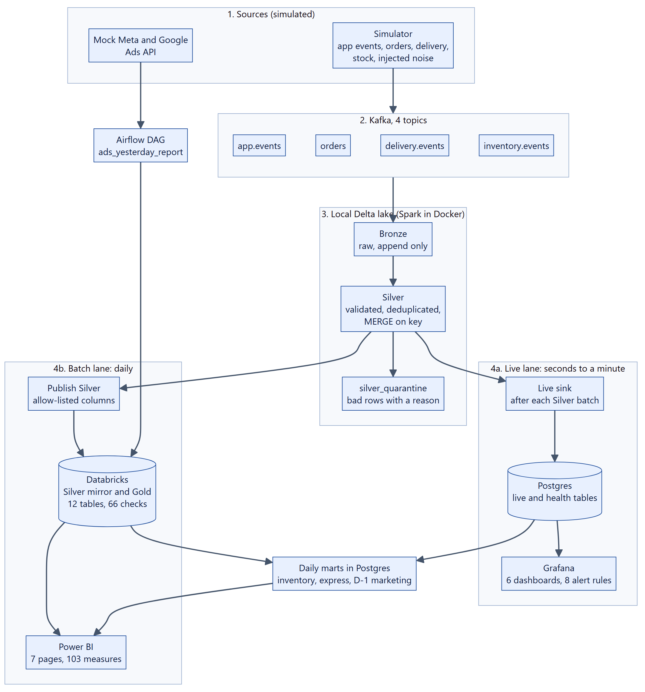

*Figure 1. End-to-end architecture. Everything left of Databricks runs on one Windows laptop in Docker.*

### 3.1 Design principles

| Principle | How it is implemented |
|---|---|
| **Medallion layers** | Bronze keeps every raw message forever. Silver is validated, typed and deduplicated. Gold is business ready. Silver and Gold can be rebuilt from Bronze |
| **At-least-once delivery with idempotent writes** | Kafka producers use `acks=all` and idempotence. Silver deduplicates on `event_id` and writes with a Delta `MERGE`. Gold upserts on its primary key. The result is exactly-once in effect, without a broker switch |
| **Single writer per table** | Every Gold table is written only by the Databricks Gold build. The local Spark stream writes only Bronze, Silver and the live tables |
| **Two lanes** | A live lane for seconds-to-minutes decisions in Grafana. A batch lane for trusted, reconciled daily numbers in Power BI |
| **Contracts at the door** | A validator checks every event against a versioned schema. A bad event goes to quarantine with an error code, never into the numbers |
| **Declared definitions** | One metric dictionary (`docs/metrics.md`) defines every KPI. Dashboards repeat the definition next to the number |
| **Fallbacks** | A `GoldStore` interface has a Databricks and a Postgres backend, so the Gold tables can load into Postgres if Databricks is unavailable. The Airflow steps also run as a Python script |

### 3.2 Technology

| Layer | Technology | Why |
|---|---|---|
| Event transport | Apache Kafka 3.7 (KRaft), 4 topics | Decouples producers and the lake, keeps messages while the job is down, replays after a crash |
| Stream processing | Spark Structured Streaming 3.5.1 in Docker, Delta Lake 3.2 | Checkpoints, `MERGE`, partitioned Delta tables. Spark needs Linux on this Windows host, so it runs in a container |
| Local lake | Delta folders under `data/lake` | No object store needed on a laptop |
| Cloud lakehouse | Databricks (Free Edition SQL warehouse, Unity Catalog `funnelstream`) | Holds the Silver mirror and the Gold star schema |
| Serving store | PostgreSQL 16 | Small, fast tables for Grafana and Power BI marts |
| Monitoring | Grafana 11.3 with provisioned dashboards and alert rules | Live view and alerts, defined as code |
| Orchestration | Apache Airflow 2.9 (optional profile) | Daily ad report; the batch also runs as a script |
| BI | Power BI Desktop (project format, Import mode) | Seven-page report on Gold and the Postgres marts |
| Tooling | Python 3.11, pytest, Docker Compose, PowerShell scripts | Reproducible runs and demos |

### 3.3 Where the code lives

| Folder | Purpose |
|---|---|
| `simulator/`, `mock_apis/` | Event generators with injected noise, stock ledger, express orders; mock Meta and Google Ads API |
| `contracts/` | Event schemas, topic configuration, the validator, the store and district map |
| `kafka/` | Topic creation |
| `streaming/` | The Spark jobs: Bronze ingest, Silver clean, the combined pipeline, live metrics |
| `warehouse/` | Table definitions, DDL generators, the Databricks and Postgres stores, publish, the Gold SQL (13 numbered steps), data quality checks, live sink, daily marts |
| `batch/`, `airflow/dags/` | Attribution and campaign batch logic, the `ads_yesterday_report` DAG |
| `monitoring/` | Python builders for the Grafana dashboards (the JSON files are generated), provisioning and alert rules |
| `dashboards/powerbi/` | The Power BI project, `measures.dax` and `MODEL.md` |
| `scripts/` | Demo, benchmark, smoke test, failure demo, publish, Gold build, daily marts |
| `src/llm/` | The LLM analytics assistant |
| `tests/` | 88 test files |
| `docs/` | Specifications, plans, metrics, running guide, this document |

---

## 4. Data sources and the simulator

The simulator is a seeded generator: the same seed gives the same customers, products and events, which makes demos and replay tests repeatable.

### 4.1 What it produces

- **App and web events** with a funnel and drop-off at each step: `app_open`, `page_view`, `product_view`, `product_click`, `product_search`, `add_to_cart`, `remove_from_cart`, `checkout_started`, `purchase`. Anonymous events have no `customer_id` and are keyed by `session_id`.
- **Orders and deliveries** created only after checkout, with a full lifecycle (section 5.4).
- **Catalog and customers**: about 200 products in four categories (fashion, beauty, electronics, home) and 5,000 customers, with price and category changes so that the slowly changing dimensions have history.
- **Campaign data** from a mock Meta and Google Ads API, consistent with the `utm_campaign` values in the traffic.
- **Stock events** for eight dark stores (section 8).

### 4.2 Egyptian realism

Egyptian names and `+20` phone numbers (kept only in Bronze and Silver); cities weighted by population (Cairo, Giza, Alexandria, Mansoura, Tanta, Assiut and others) with the official districts under each city (for example Nasr City, Maadi and Heliopolis under Cairo); EGP; payment methods cash on delivery (the largest share), Fawry, Vodafone Cash, InstaPay and card; carriers Bosta, Aramex and J&T Express; Ramadan, Eid and weekend peaks; events stored in UTC with the business day taken in `Africa/Cairo`.

### 4.3 Injected noise

The simulator injects faults on purpose, at configurable seeded rates, and writes the counts to `noise_manifest.json`. After Silver, the pipeline compares the quarantine count with the manifest; they must match within a tolerance.

| Noise | Rate | Handled by |
|---|---|---|
| Duplicate event (same `event_id`) | 1% | Silver deduplicates on `event_id` |
| Malformed or truncated JSON | 0.3% | Quarantine `BAD_JSON` |
| Missing required field | 0.3% | Quarantine `MISSING_FIELD` |
| Unknown event type or version | 0.2% | Quarantine `UNKNOWN_EVENT_TYPE`, `BAD_VERSION` |
| Negative or zero price | 0.2% | Quarantine `NEGATIVE_PRICE` |
| Future timestamp | 0.1% | Quarantine `FUTURE_TIMESTAMP` |
| Late event (10 to 120 minutes) and very late | 2% and 0.3% | `is_late` flag, left out of live metrics, corrected by the batch |
| Timestamp with a non-UTC offset | 1% | Normalised to UTC |
| Product id not in the catalog, null product id | 0.3% and 0.5% | Quarantine `UNKNOWN_PRODUCT`, `MISSING_FIELD` |
| Dirty `city`, `device`, `district` text | 3% and 2% | Standardised by lookup |
| UTM values upper-cased or padded | 5% of campaign URLs | Lower-cased and trimmed |
| Number sent as a string | 0.3% | Cast, quarantined if it fails |
| Order status out of order, cancel after shipment | 0.5% and 0.3% | Resolved by status rank; the cancel goes to quarantine |
| Bot session (hundreds of events in seconds) | 0.1% of sessions | `is_bot` flag, left out of funnel and attribution |
| Ad API: duplicate pull, `clicks > impressions`, negative spend, HTTP 503 | small | Latest-pull rule, SQL checks, Airflow retries |

Synthetic data cannot be proven fully realistic. The assumptions are documented and the distributions are checked against them.

---

## 5. The streaming pipeline: Kafka, Bronze and Silver

### 5.1 Kafka topics

| Topic | Event types | Key | Partitions |
|---|---|---|---|
| `app.events` | `app_open`, `page_view`, `product_view`, `product_click`, `product_view_end`, `product_search`, `add_to_cart`, `remove_from_cart`, `checkout_started`, `purchase` | `session_id` | 6 |
| `orders` | `order_created`, `payment_authorised`, `order_packed`, `order_shipped`, `order_cancelled`, `order_completed`, `order_returned` | `order_id` | 3 |
| `delivery.events` | `out_for_delivery`, `delivered`, `delivery_failed` | `order_id` | 3 |
| `inventory.events` | `stock_snapshot`, `stock_movement` | `store_id` | 3 |

Keys keep per-session and per-order ordering. Every event uses one envelope: `event_id`, `event_type`, `event_version`, `event_time` and a `payload` object.

### 5.2 Bronze

Bronze tables hold the raw message value plus Kafka metadata (partition, offset, timestamp) and the ingest time. Nothing is dropped or changed. Bronze is append-only and is the source for any rebuild.

### 5.3 Silver

Silver validates, types, normalises and deduplicates. Every table has a key, and every write is a Delta `MERGE` on that key, so replaying a batch changes nothing.

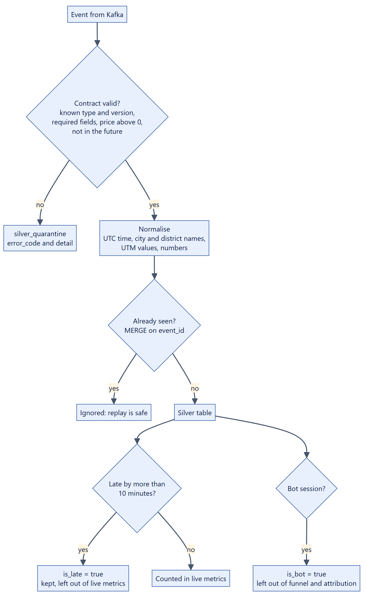

*Figure 2. What happens to an event on its way into Silver.*

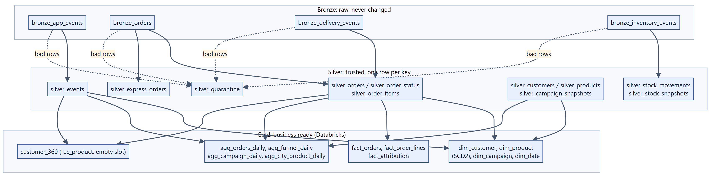

*Figure 3. The three layers and the tables in each.*

| Silver table | Grain | Key |
|---|---|---|
| `silver_events` | one app or web event | `event_id` |
| `silver_orders`, `silver_order_status` | order, and each status change | `order_id`; `event_id` |
| `silver_order_items` | one order line | `order_id`, `line_no` |
| `silver_stock_movements`, `silver_stock_snapshots` | one stock event | `event_id` |
| `silver_express_orders` | one express order | `order_id` |
| `silver_customers`, `silver_products` | one version of an entity | id and `updated_at` |
| `silver_campaign_snapshots` | one campaign per report date per pull | `campaign_id`, `report_date`, `pulled_at` |
| `silver_quarantine` | one rejected row | none |

Key Silver rules:

- `is_late` is true when Kafka time minus event time exceeds 10 minutes. Late rows stay in Silver and Gold but are left out of the live metrics.
- A micro-batch is deduplicated on its key before the `MERGE`, so two rows with the same key never meet in one merge.
- A cancel after `order_shipped` is rejected to quarantine.
- Silver can be rebuilt from Bronze at any time.

### 5.4 The order lifecycle

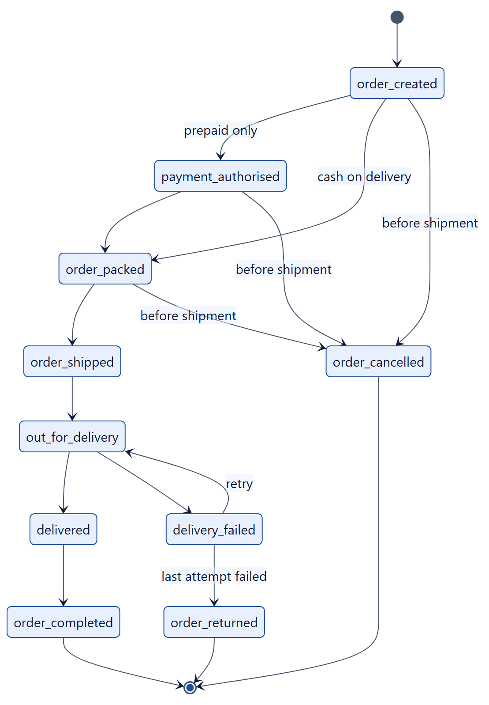

*Figure 4. Order lifecycle. Cash-on-delivery orders skip `payment_authorised`. A cancel is valid only before shipment, judged by event time.*

Arrival order is not trusted. The current status of an order is the status with the highest **rank**: `order_created` 1, `payment_authorised` 2, `order_packed` 3, `order_shipped` 4, `out_for_delivery` and `delivery_failed` 5, `delivered` 6, `order_completed` and `order_returned` 7 (a tie is resolved by the latest status time), `order_cancelled` 2 and terminal.

### 5.5 Reliability

| Failure | What protects the data |
|---|---|
| Spark job killed | Checkpoints on disk hold the committed Kafka offsets. The restarted job resumes from them and reads what Kafka kept |
| Message delivered twice | `MERGE` on the key inserts nothing the second time |
| Event arrives late or out of order | `is_late` flag; status rank; stock is recomputed in full, never incremented |
| Bad message | Quarantine with an error code and the raw payload |
| Postgres briefly unavailable | The live sink keeps the touched minutes pending and retries on the next batch; Silver is the source of truth |
| A Gold step fails | The Gold build stops on failed checks and nothing downstream is trusted |

### 5.6 Performance

On one laptop (12 CPUs, Docker limited to about 8 GB) the benchmark of 1,000,000 simulated events (1,022,333 Kafka messages) ran the whole pipeline in 654.73 seconds. See section 11.4.

---

## 6. Live serving and monitoring: Postgres, Grafana and alerts

After each Silver batch a **live sink** recomputes only the minutes and the store and product pairs that the batch touched, and writes them to Postgres. Grafana reads Postgres with a read-only role (`grafana_ro`).

### 6.1 Postgres live and serving tables

| Table | Content |
|---|---|
| `live_metrics_minute` | events, active sessions, product views, add to cart, orders per minute and country (non-late, non-bot events) |
| `pipeline_health_minute`, `pipeline_batch_log`, `pipeline_heartbeat` | late and quarantined counts per minute, one row per batch, a heartbeat per component |
| `live_stock_now`, `live_stock_store_minute` | current stock per store and product; a per-minute snapshot per store (kept 24 hours) |
| `live_oos_demand_minute` | demand per minute, store, product and campaign, with the flag *out of stock when the minute was written* |
| `live_express_orders` | express orders of the last three hours with their own promise |
| `dim_store`, `dim_store_district`, `dim_product_current` | the store map and current product names, filled once from one source |
| `inventory_daily`, `oos_demand_daily`, `express_daily`, `marketing_d1_campaign`, `marketing_d1_product` | daily marts (section 7.5) |

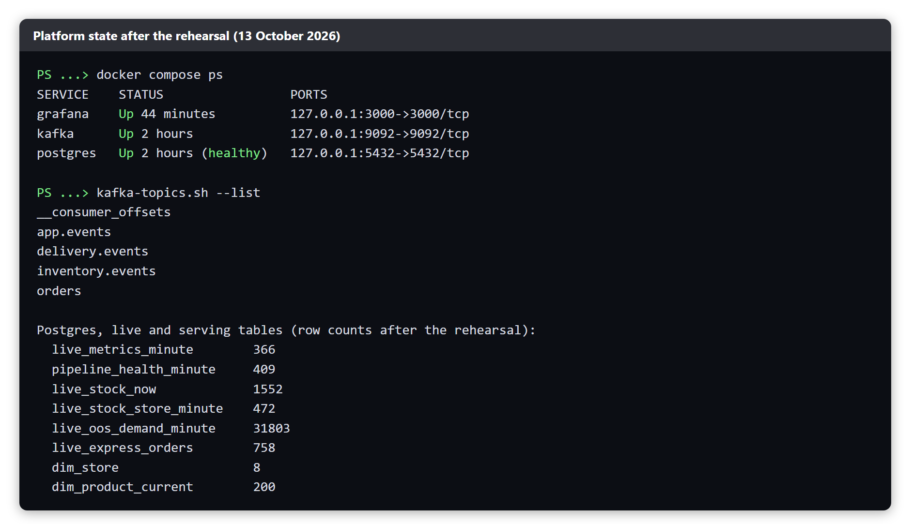

*Figure 5. The running platform after the rehearsal of 13 October 2026: containers, the four Kafka topics and the row counts of the live tables.*

### 6.2 Dashboards

Six dashboards are provisioned as code: Python builders in `monitoring/` generate the JSON, and a test fails if a file drifts from its builder. All use one Postgres data source.

#### Live pipeline (`fs-live`)

Watches the pipeline itself: events per minute, active sessions, orders, product views and add-to-cart, the late-event rate and the quarantine share, quarantine rows per hour, and the age of the Silver heartbeat, the last Gold update and the last publish.


*Figure 6. "FunnelStream: live pipeline" during the rehearsal: about 2,400 to 2,950 events per minute.*

#### Operations, live inventory (`fs-inventory-ops`)

The operations user's page: out-of-stock and low-stock products now, how old the last stock change is, demand that arrived on out-of-stock products per minute (the bridge panel), app traffic, the lowest stock and the lost demand of the last 15 minutes, and an express section with at-risk orders, breaches, the on-time rate and the slowest orders.


*Figure 7. "FunnelStream: Operations, live inventory". The express section shows breaches because the rehearsal used a 2-minute promise and delivered every 15th order late on purpose.*

#### Express delivery SLA (`fs-express-sla`)

Dedicated to the 20-minute promise: on-time rate (target 95%) with colours at 90 and 95, breaches, orders at risk, open orders, the median delivery time, the on-time rate and the p50 and p90 delivery time by order creation time, a table by store and the open orders closest to their promise. Empty five-minute buckets are shown as gaps, not as 0%.


*Figure 8. "FunnelStream: Express delivery SLA". The dashed line is the 95% target.*

#### Live stock monitor (`fs-live-stock`)

Out-of-stock, low-stock, the in-stock rate and units on hand; out-of-stock products and units on hand per store over time (from the per-minute snapshots); units added and removed per minute; demand on empty shelves; a stock health table by store and a restock watchlist.


*Figure 9. "FunnelStream: Live stock monitor".*

#### Inventory insights, daily (`fs-inventory-daily`)

Closing stock, products out of stock at day end, oversold units, shrinkage share, closing stock by store, units sold, received and shrunk, lowest days of cover, demand on empty shelves and the express on-time rate and slowest delivery per day.


*Figure 10. "FunnelStream: Inventory insights, daily".*

#### Marketing, D-1 (`fs-marketing-d1`)

Yesterday's spend, orders, ROAS placed and delivered, the estimated spend exposed to out-of-stock products and the out-of-stock click share, a campaign table sorted by exposed spend and the top products by revenue at risk.


*Figure 11. "FunnelStream: Marketing, D-1".*

### 6.3 Alert rules

Eight rules are provisioned. Each has a condition, a runbook line and a webhook to a local alert sink.

| Rule (uid) | Fires when | For |
|---|---|---|
| Late-event rate above 5% (`fs-late-rate`) | late events over the last 5 minutes exceed 5% with at least 20 events | 1m |
| Quarantine share above 2% (`fs-quarantine-share`) | quarantined rows over the last 5 minutes exceed 2% with at least 20 rows | 1m |
| Silver job silent for 2 minutes (`fs-silver-silent`) | the Silver heartbeat is older than 2 minutes (no data also fires) | 0 |
| No events for 5 minutes (`fs-no-events`) | no Silver event arrived in the last 5 minutes (no data also fires) | 0 |
| Demand on out-of-stock products (`fs-oos-demand`) | at least 5 add-to-carts on an out-of-stock product of one store in each of two consecutive minutes | 0 |
| An express order missed its delivery promise (`fs-express-sla`) | any breach: delivered after the promise, or undelivered beyond the promise plus a 1-minute grace | 0 |
| Express on-time rate is below the 95% target (`fs-express-ontime`) | on-time rate below 95% over 30 minutes with at least 5 orders | 2m |
| Many products are out of stock in one store (`fs-stock-outs`) | more than 20% of a store's products are out of stock | 1m |

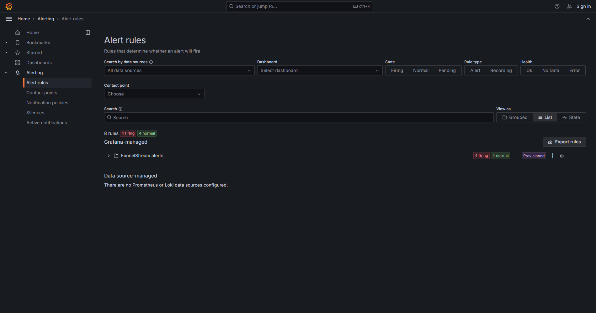

*Figure 12. The provisioned rules in Grafana (8 rules). The four firing at capture time were firing because the rehearsal pipeline had been stopped, which is what the silence and no-events rules are meant to detect.*

---

## 7. The batch lane: Databricks Gold, checks and daily marts

### 7.1 Publish to Databricks

Databricks cannot reach the laptop's Kafka, so Silver crosses as files. `scripts/publish_silver.py` exports the Silver tables with an allow-list of columns (no names or phone numbers), uploads Parquet to a Unity Catalog volume and `MERGE`s it into the Silver mirror (insert-only and idempotent). An optional `--reset` truncates the owned mirror tables before a fresh publish.

### 7.2 The Gold model

Gold is written only by the Databricks Gold build, as 13 numbered SQL steps (step 12, `rec_product`, is an empty slot).

| Table | Grain | Notes |
|---|---|---|
| `dim_customer` | customer version | SCD2: tracked `city`, `district`, `primary_device`; `valid_from`, `valid_to`, `is_current` |
| `dim_product` | product version | SCD2: tracked `category`, `price`, `is_active` |
| `dim_campaign`, `dim_date` | campaign; day | `dim_date` flags weekend, Friday and Saturday, Ramadan, Eid and holidays. Key `-1` is the unknown member of the other dimensions |
| `fact_orders` | order, current state | resolved by status rank; delivery lead hours; cancelled, delivered, returned and first-attempt flags; first-order flag |
| `fact_order_lines` | order line | quantity and line total in EGP |
| `fact_attribution` | order and model | `last_touch` and `first_touch`; direct orders have a NULL campaign |
| `agg_orders_daily` | day, channel, payment method, platform | placed, delivered, cancelled, returned and failed-attempt orders and revenue |
| `agg_funnel_daily` | day, country, channel, platform | sessions, cart and checkout sessions, orders, abandon rates |
| `agg_campaign_daily` | campaign, report date, model | spend, impressions, clicks, orders, ROAS placed and delivered, CPA, cost per delivered order |
| `agg_city_product_daily` | city, product, day | views, add to cart, units, revenue |
| `customer_360` | customer, current state | orders, spend, last order, preferred payment, repeat buyer |

Dimension keys are resolved when the fact is built, from the dimension version valid at event time. Rows without a match go to quarantine, not to a guessed key.


*Figure 13. Gold build on the scratch catalog, 13 October 2026: `BATCH OK`, 66 checks run, 0 failed. The excerpt shows the reconciliation, SCD2 and quarantine-against-manifest checks.*

### 7.3 Attribution

`last_touch` gives an order to the campaign of its own session click first, and otherwise to the customer's last click in the previous seven days. `first_touch` gives it to the first click. An order without a click is direct. The report states both, because last touch favours bottom-funnel channels such as search and retargeting, and neither proves incrementality.

### 7.4 Data quality checks

The build runs 66 SQL checks and stops on a failure. They fall into groups:

| Group | Examples |
|---|---|
| Duplicate keys | every Silver and Gold table has zero duplicate primary keys |
| Silver hygiene | no null `event_id`, no event in the future, no unknown product, every status allowed, `line_total = quantity x unit_price`, no `clicks > impressions`, no negative spend |
| Hierarchy and history | exactly one current row per dimension key, no overlapping validity, district belongs to its city |
| Reconciliation | `order_total` equals the sum of its lines; the order and line counts in Gold match Silver; attribution has two rows per order and its total matches the order total |
| Manifest | the quarantine count equals the noise manifest within 2% |
| Reported | late rate, quarantine share, row counts per table |

### 7.5 Daily marts and the ad report

Two daily builders write Postgres tables that Grafana and Power BI read:

- `scripts/build_inventory_daily.py` rebuilds the last two Cairo days of `inventory_daily`, `oos_demand_daily` and `express_daily`. Rebuilding two days settles an order that was still open at midnight.
- `scripts/build_d1_marketing.py` builds `marketing_d1_campaign` and `marketing_d1_product` for day minus one: spend, ROAS and CPA come from the Databricks `agg_campaign_daily`; out-of-stock demand comes from the Postgres live demand table.

The Airflow DAG `ads_yesterday_report` (03:00 Cairo time) pulls the ad API once for yesterday, stores it in `silver_campaign_snapshots` and writes a JSON report. A rerun on the same day returns the stored report without calling the API.

---

## 8. Inventory and express delivery

This feature joins the two users. Stock is simulated for eight dark stores: Nasr City, Maadi and New Cairo in Cairo; Dokki in Giza; Montaza and Raml in Alexandria; one in Mansoura; one in Tanta. Each district has one primary store. Assiut and "other" have no store and are excluded from out-of-stock metrics.

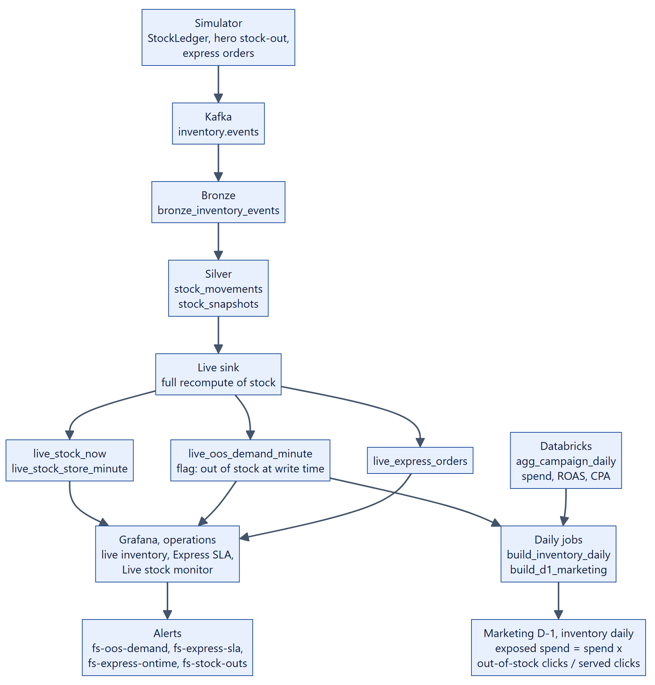

*Figure 14. From a stock event to the operations alert and the next-morning marketing number.*

### 8.1 The stock model

A `StockLedger` in the simulator holds stock per store and product and never lets it go below zero. It emits an opening snapshot for every pair, a baseline snapshot every five minutes and a `sold` movement for each order line. A sale is booked when the order is created (reserve on order). Demand events are not stopped by empty stock: that is the lost demand. A **product is out of stock** when `available <= 0`, and **low** when `0 < available < reorder point`.

The **hero scenario** (`--scenario hero-stockout`) makes three hero products at the busiest store start with 40 units, boosts their views and add-to-carts, and restocks them about 90 seconds after the stock-out. The same seed gives the same demo.

### 8.2 Express orders

Orders from the quick-commerce section carry `service = express` and their own `promised_minutes` (20). A normal express order takes 8 to 17.5 minutes. Definitions used everywhere: **on time** means delivered within the order's promise; **breached** means delivered later, or still undelivered beyond the promise plus one minute of grace; **at risk** means undelivered with at least 75% of the promise used. A rehearsal can shorten the promise and force late orders (`--express-promise-minutes 2 --late-express-every 15`).

### 8.3 Exposed spend, the bridge

```
oos_click_share = out-of-stock landing clicks / served landing clicks
exposed_spend   = spend x oos_click_share
revenue_at_risk = add-to-carts on out-of-stock products x price
```

Both click counts come from the same table and count only served districts. The advertising API gives spend per campaign per day only, so exposed spend assumes spend is spread evenly over served landing clicks. It is titled "estimated spend exposed to out-of-stock". It is not a measured loss and not "wasted", because a shopper may buy a substitute.

### 8.4 Measured timeline of the demo

Measured on 12 October 2026 (Windows laptop, Docker with 8 GB, a clean lake, `-Rate 10 -SyncEvery 0 -Inventory`, times from Postgres and the alert sink):

| Step | Measured |
|---|---|
| Stock rows and per-minute history appear | with the first Silver batches; one history row per store per minute |
| First hero product reaches `available = 0` | about 4 minutes after the demo command (Galabeya 61 at Nasr City, 21:16:14 Cairo time) |
| Alert "Demand on out-of-stock products" fires | 1 minute after the stock-out, resolves 1 minute later |
| Restock | about 2 minutes after the stock-out; the out-of-stock count falls to 0 |
| Express rehearsal | 33 express orders, 31 on time, 2 breached; first breach about 7 minutes after the command |

---

## 9. The Power BI report

The report is a Power BI project in `dashboards/powerbi/` (a `.pbip` with a report and a semantic model folder). It reads two sources in Import mode, with read-only credentials: eleven Databricks Gold tables and seven Postgres marts (nineteen tables with the measures table), joined by 27 relationships.

### 9.1 Model

The report sits at the end of both lanes (Figure 1). The model is a star: four dimensions and the facts around them.

| Dimension | Relates to (many side, single direction, many-to-one) |
|---|---|
| `Date` (`date_key`) | `Orders Daily`, `Orders`, `Campaign Daily`, `Funnel Daily`, `Inventory Daily`, `OOS Demand Daily`, `Marketing D1 Campaign`, `Marketing D1 Product` |
| `Campaign` (`campaign_id`) | `Campaign Daily`, `Marketing D1 Campaign`, `OOS Demand Daily`, `Orders` |
| `Store` (`store_id`) | `Stock Now`, `Inventory Daily`, `OOS Demand Daily`, `Express Daily`, `Marketing D1 Product` |
| `Product` (`product_id`) | `Stock Now`, `Inventory Daily`, `OOS Demand Daily`, `Marketing D1 Product` |

There is no many-to-many relationship and no bidirectional filter. `Customer` and `Customer 360` follow their own columns. The report shows `customer_id` only: no names or phone numbers.

### 9.2 Design system

The report was redesigned on 12 October 2026 around one design identity: a navy header band on every page with a one-line takeaway as its subtitle, one blue accent for the primary series and orange for the comparison, status colours only with a word, Segoe UI, a 1280 x 720 canvas on a computed grid with equal margins and gaps, at most three slicers per page (64 pixels tall, dropdown), six cards at most per row with labels of at most 24 characters, ranked bars instead of pie and donut charts, and units in titles. Cards never show "(Blank)": the measures return a value for an empty slice.

### 9.3 The seven pages

Each page answers one question.

#### 1. Executive: is revenue on track, and where do orders leak?

Placed and delivered revenue, orders, average order value, delivered share and cancel rate; revenue by day; orders by channel and payment method; the leak by payment method (cancelled, returned and failed-attempt rate). The subtitle states that the simulated data has a one-day volume peak on 9 October (about 55% of all revenue on one day).

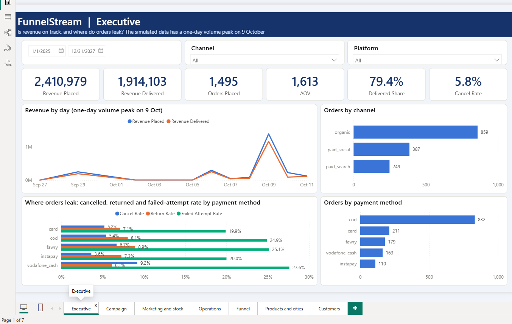

*Figure 15. Executive page.*

#### 2. Campaigns: where should the next budget go?

Spend, CPA, CTR, conversion rate and ROAS delivered; ROAS delivered against placed by campaign; cost per delivered order; a campaign scorecard. The subtitle reminds the reader that ad numbers use the Cairo day and that the latest days are still settling.

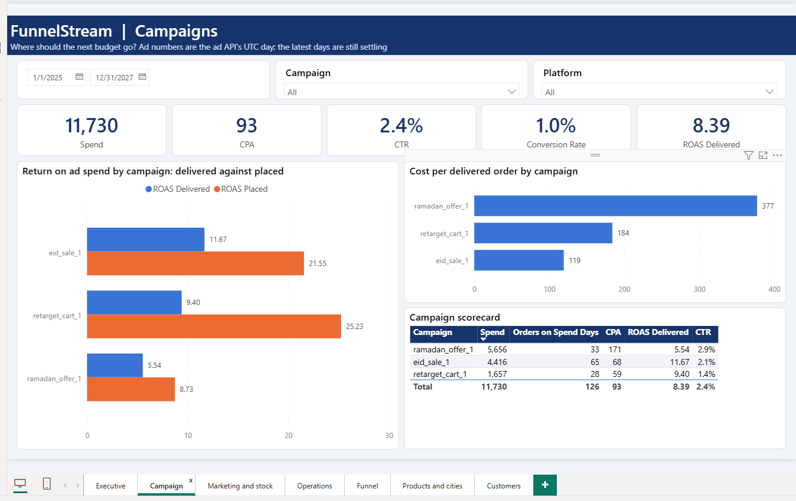

*Figure 16. Campaigns page.*

#### 3. Marketing and stock: which campaign sent shoppers to empty shelves?

Exposed spend, out-of-stock click share, exposed share of spend, revenue at risk and out-of-stock add to cart; exposed spend next to each campaign's own spend; products by revenue at risk; add to cart on out-of-stock products by category.

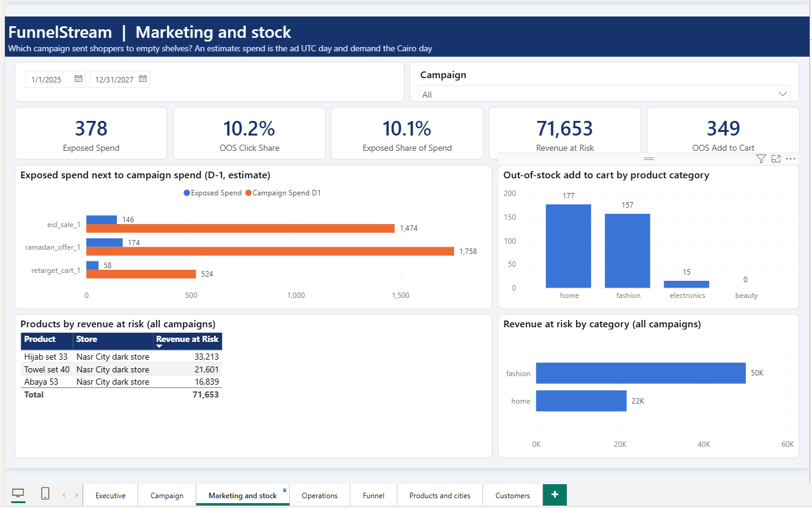

*Figure 17. Marketing and stock page.*

#### 4. Operations: what to restock, and is the 20-minute promise holding?

Out-of-stock and low-stock lines and rate, express orders, the express on-time rate and breaches; units sold and received by day; shrinkage rate by store; products that ended out of stock; express breaches by store; average delivery hours by carrier (all orders, standard delivery).

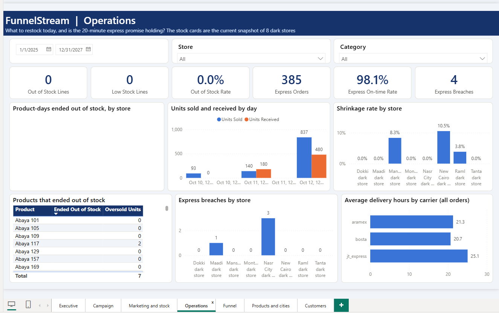

*Figure 18. Operations page.*

#### 5. Funnel: which step and channel should we fix first?

Cart abandon rate, checkout abandon rate and session conversion; the funnel from sessions to orders; abandon rate by channel; sessions by channel.

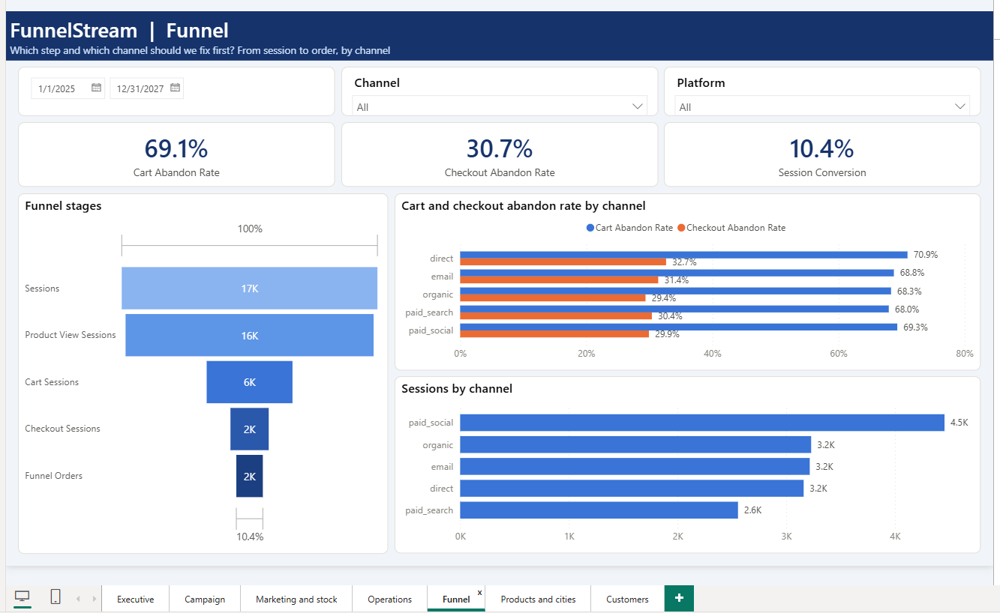

*Figure 19. Funnel page.*

#### 6. Products and cities: what should we stock and promote, and where?

Revenue, units, page views, add to cart and cart rate; revenue by category and by city; add to cart by category; top products.

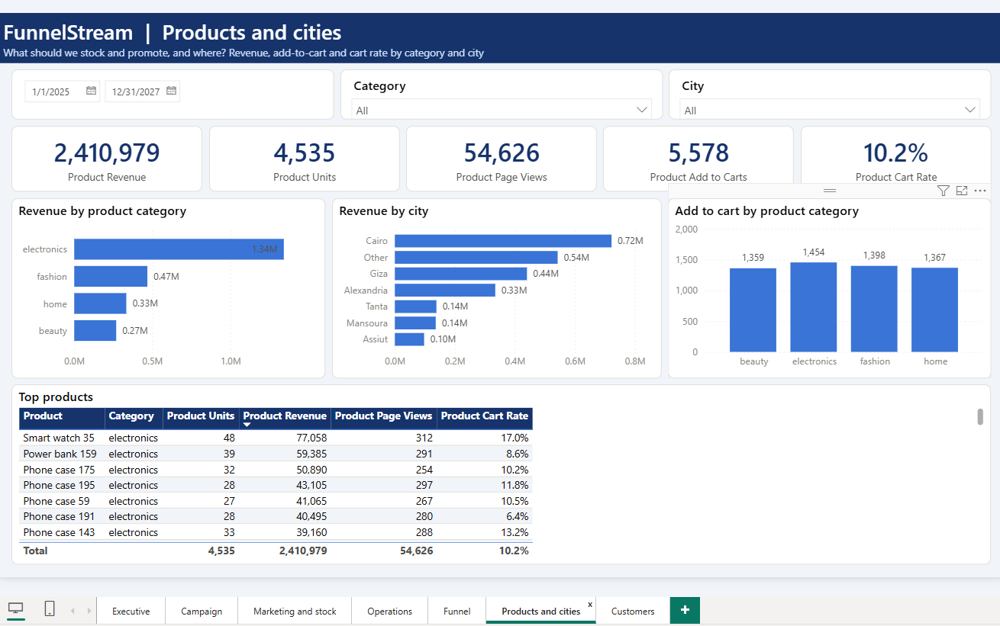

*Figure 20. Products and cities page.*

#### 7. Customers: who buys again, and who should we win back?

Customers on file, buyers, repeat buyer rate, lifetime spend, average spend per buyer and quiet buyers (7 or more days since the last order); buyers by favourite category and payment method; lifetime spend by category and city; top customers.

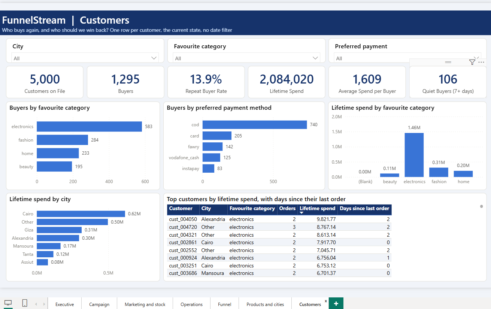

*Figure 21. Customers page.*

### 9.4 Notes on specific measures

| Measure | Behaviour |
|---|---|
| `Revenue vs Prior 7 Days` | Latest seven days against the seven before, from explicit date ranges. On this data it reads very high because of the 9 October spike |
| `Average Delivery Hours` | Ignores delivered orders with zero hours. Carrier averages are about 21 to 25 hours; the earlier 4 to 5 hours were diluted by those zeros |
| `Days of Cover (max 90)` | Capped at 90 so a slow product does not dominate the axis |
| `Quiet Buyers (7+ days)` | Replaces a 30-day measure that was empty, because the data covers about 15 days |
| `Maturity Label` | "Settling" or "Settled", marking days whose delivered revenue can still grow |
| Cart and checkout abandon rate | Blank for an empty slice and clamped to 0 to 1, never 100% |

### 9.5 Refreshing the report

Open `FunnelStream.pbip` in Power BI Desktop. Desktop asks for a read-only Databricks token and the `grafana_ro` Postgres password (credentials are never stored in the file). After a Gold batch and the two Postgres builders, use Refresh. The generator `scripts/make_pbip.py` rebuilds the whole report folder from code and must not be run over the saved project except deliberately; backups exist under `data/_archive/`.

---

## 10. Metric dictionary

The full dictionary with formulas and filters is in `docs/metrics.md`. The headline definitions:

| Metric | Formula | Notes |
|---|---|---|
| ROAS delivered | `revenue_delivered / spend` | Headline. Delivery lags spend by about 2 to 4 days, so recent days read low and are labelled provisional |
| ROAS placed | `revenue_placed / spend` | Secondary |
| CPA | `spend / orders_placed` | Placed orders |
| Cost per delivered order | `spend / orders_delivered` | Delivered orders only |
| Conversion rate | `orders_placed / sessions` | Per channel |
| Cart abandon rate | `1 - orders_placed / cart_sessions` | Sessions with add to cart |
| Checkout abandon rate | `1 - orders_placed / checkout_sessions` | Sessions that started checkout |
| Cancel, return, failed-attempt rate | cancelled, returned, or at least one failed attempt, over placed orders | |
| First-attempt delivery rate | first-attempt deliveries / shipped orders | |
| Average order value | `revenue_placed / orders_placed` | |
| Delivery lead time | average `delivered_at - order_created_at` | Delivered orders |
| Out-of-stock click share | out-of-stock landing clicks / served landing clicks | Served districts only |
| Exposed spend | `spend x out-of-stock click share` | An estimate |
| Express on-time rate | on time / (on time + breached) | Target 95% |

One day definition applies everywhere: every date, including the ad report day, is a **Cairo day** (Africa/Cairo, with daylight saving). Timestamps are stored as exact instants (UTC) and shown in Cairo time.

---

## 11. Quality assurance and measured results

### 11.1 Automated tests

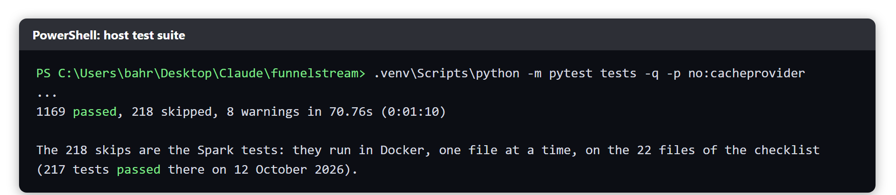

*Figure 22. The full host test suite on 13 October 2026.*

| Level | What | Result |
|---|---|---|
| Host tests | contracts, validator, simulator, Silver transform, store and warehouse logic, Gold SQL files, data quality definitions, Grafana JSON and alert rules, Power BI generator and measures, the LLM assistant guards | 1,169 passed, 0 failed, 218 skipped (the Spark tests) |
| Spark tests (Docker, one file at a time) | Bronze, Silver, the live sink, replay, a crash in the middle of a batch, late and duplicate events, stock never negative, Gold build | 22 files, 217 tests passed on 12 October 2026 |
| Smoke test | `scripts/smoke_test.py` walks 15 stages from the simulator to the Power BI source check in an isolated lake and database and writes a report | see 11.3 |
| Benchmark | 1,000,000 events end to end | see 11.4 |
| Failure demo | kill the Silver job, restart it, check for duplicates | see 11.5 |

### 11.2 Duplicate check after a crash and restart

`scripts/check_duplicates.py` reads every Silver table that has a key and reports duplicates. On the lake of the 13 October rehearsal:

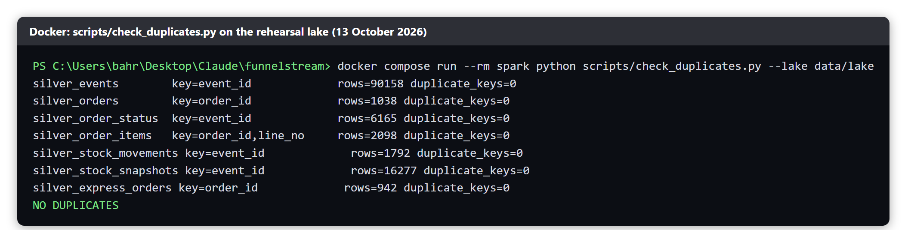

*Figure 23. `NO DUPLICATES` across the seven keyed Silver tables.*

### 11.3 Smoke test

The first complete run (13 October 2026, without the Spark test stage) showed 10 stages passing and three failing. None was a pipeline defect:

| Stage | Result | Cause and fix |
|---|---|---|
| Host tests | pass | 1,153 passed at the time |
| Reset and generate, Bronze and Silver | pass | 22,274 messages produced, Bronze 22,274 rows (exactly equal), Silver tables non-empty with no duplicate key |
| Daily marts, Alert logic, Replay safety | pass | Replay of Bronze left 10 Silver tables unchanged |
| Power BI source check | pass | 11 Gold and 7 Postgres source tables exist; 79 column references of 68 measures resolve |
| Data invariants | fail, fixed | `live_metrics_minute` was empty: the run replays days of history, every event is late, and that table leaves late events out by design. The check no longer requires that table |
| Dashboards run | fail, fixed | The test's stand-in for Grafana's `$__timeFrom()` placed a cast on the interval instead of the whole window. Fixed in the macro expansion |
| Databricks batch | fail, fixed | The insert-only `MERGE` kept rows of earlier runs in the scratch catalog (manifest check: 308 expected, 15,472 observed). The stage now publishes with `--reset`, and `scripts/reset_scratch_gold.py` empties the scratch Gold tables |

After the fixes, the Gold stages were rerun on the scratch catalog: `BATCH OK` in 175.6 seconds with 66 checks and 0 failures, and the quarantine count matched the manifest (308 expected, 308 observed). The marketing D-1 mart built three campaign rows for the data day 2026-10-07. A single uninterrupted green run of all stages is on the list of open items (section 15).

### 11.4 Benchmark

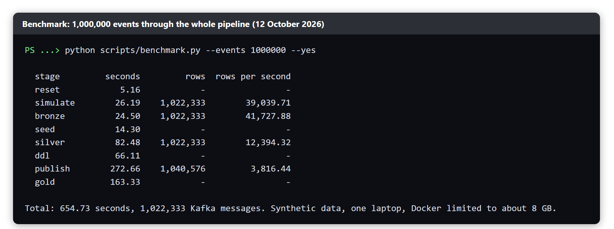

*Figure 24. Benchmark of 12 October 2026 (`docs/benchmark.md`).*

The numbers measure this one setup and are not a capacity claim. The Databricks stages ran on a Free Edition SQL warehouse.

### 11.5 Failure demo

The story: kill the Spark job while data flows, watch Grafana and the alert notice, restart with the same checkpoints, show that Silver has no duplicates.

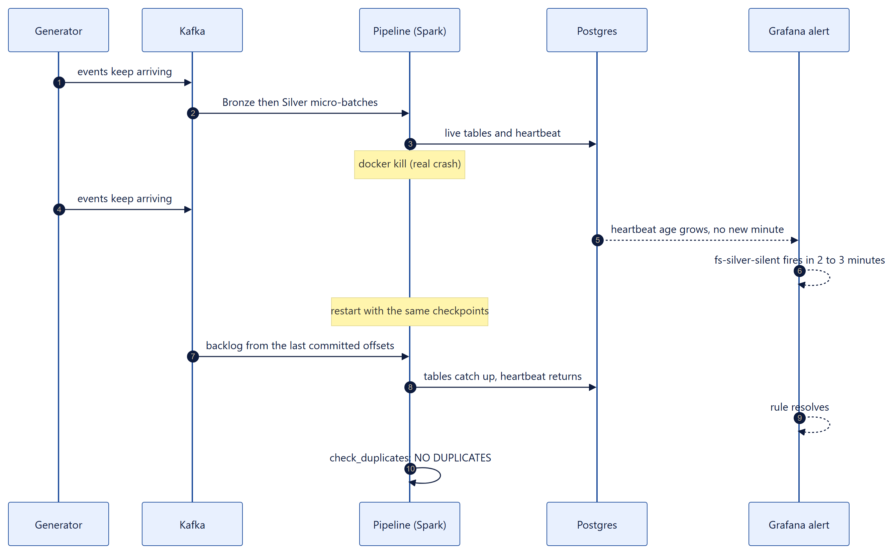

*Figure 25. Failure demo sequence.*

Measured on 12 October 2026, twice in a row, on a clean lake (Cairo time):

| | Run 1 | Run 2 |
|---|---|---|
| Kill | 21:40:05 | 21:45:23 |
| "Silver job silent for 2 minutes" fired | 2 min 12 s after the kill | 2 min 54 s after the kill |
| Heartbeat back under 30 s | about 40 s after the restart | about 35 s after the restart |
| Duplicate check after restart | NO DUPLICATES (8,469 events, 123 orders, 217 stock movements) | NO DUPLICATES (16,404 events, 210 orders, 367 stock movements) |

The promise to make is "within 3 minutes", not "within 2". The check covers Silver only: it does not look at Bronze (append-only, may hold re-delivered messages) and does not prove that no event was lost.

### 11.6 Dashboard rehearsal of 13 October 2026

A live rehearsal with the inventory scenario ran about 30 minutes. All 64 panel queries of the six dashboards were executed against the live database without error. The rehearsal drove fixes that are now in the repository: gaps instead of zero-fill on rates and stock levels, leftover express orders from earlier runs no longer shown as open, one colour rule at the 95% target for every on-time rate, a neutral dash for "no data", thousands separators instead of "4 K", and readable headers on the marketing tables.

---

## 12. Security and privacy

| Topic | Practice |
|---|---|
| Secrets | `.env` is never committed. `.env.example` lists names only (Postgres, Databricks host, token, warehouse id, catalog, volume, Grafana passwords, optional `ANTHROPIC_API_KEY`) |
| Network exposure | Kafka, Postgres, Grafana and Airflow ports are bound to `127.0.0.1` only |
| Databricks | Power BI and Grafana use read-only credentials. The write token is used only by the load jobs and never goes into a Power BI file. The smoke test refuses to touch the real catalog and works in a scratch catalog |
| Postgres | Grafana and Power BI use the read-only role `grafana_ro` with SELECT on named tables |
| Personal data | Names and phone numbers exist only in Bronze and Silver and are not published to the Databricks mirror (allow-listed columns). Gold and Power BI hold `customer_id` only. All data is synthetic |
| Destructive actions | Lake resets, truncates and Databricks resets need explicit approval and are scripted with a plan-only mode |
| Repository hygiene | `.env`, `.venv`, `data/` and scratch folders are git-ignored |

---

## 13. The LLM analytics assistant

`src/llm/` lets a user ask questions in natural language about the generated data ("Which campaign had the highest CTR?"). The model writes one `SELECT` at a time, which runs against read-only DuckDB views.

| Guard | Behaviour |
|---|---|
| No file or network access | File access is switched off and the configuration locked after the data is loaded |
| Limits | 20 second time limit and a 200 row cap per query |
| Data is not instructions | Query results are wrapped in `<query_result>` tags and cut, so data cannot pass for instructions |
| No personal data | The model does not receive names or phone numbers |
| Keys | The API key is read from the environment or `.env` (only the LLM settings are loaded) and is never logged; the Streamlit key field is not pre-filled |
| Errors | API calls have a 60 second timeout and 3 retries; errors become plain messages |

Sources are `sim` (default, generated in memory with the project's simulator, no Docker needed), `csv`, `kafka` and `delta`. Run `python src/llm/agent.py "question"` or `streamlit run src/llm/app.py`. The guards are tested in `tests/test_llm_assistant.py`.

---

## 14. Running the project

### 14.1 Prerequisites

Windows 11, Docker Desktop with about 8 GB of memory, Python 3.11. Java and Spark live inside the Docker image; do not install them on the host. Before a live demo: at least 4 GB of free RAM (6 GB is better), synchronise the clock (`w32tm /resync /force` in an administrator shell), prevent sleep, and switch Docker Resource Saver off.

### 14.2 First-time setup

```powershell
Copy-Item .env.example .env                       # then set your own passwords; never commit .env
python -m venv .venv
.venv\Scripts\python -m pip install -r requirements.txt
docker compose build spark
docker compose up -d kafka postgres grafana
.venv\Scripts\python kafka/create_topics.py
docker compose run --rm spark python scripts/seed_silver_reference.py --lake data/lake
```

### 14.3 Live demo

```powershell
.\scripts\watch_demo.ps1 -Inventory -Events 60000      # Kafka, pipeline and generator windows; Grafana at http://localhost:3000
.\scripts\watch_demo.ps1 -Inventory -ExpressPromiseMinutes 2 -LateExpressEvery 15   # fast express rehearsal
.\scripts\stop_demo.ps1
```

`watch_demo.ps1` starts Kafka, Postgres and Grafana, creates the topics, applies the live DDL and opens the windows. Each round of the generator runs its stock and express timeline to the end before the next round starts, so a short round leaves a quiet gap in the traffic panels. A longer round keeps traffic on for longer: a 30,000-event round gave about 8 minutes of continuous traffic followed by a gap of about 4 minutes in the rehearsal, and `-Events 60000` should double the traffic window (not yet rehearsed).

**Start from a clean state.** Old Bronze and Silver data and old checkpoints make Silver work through a backlog first. Move `data/lake` and `data/checkpoints` aside, recreate Kafka (`docker compose rm -sf kafka`, then `docker compose up -d kafka`), empty the live Postgres tables and start again. The smoke test recreates Kafka too, so delete `data\checkpoints` after it.

### 14.4 Failure demo

```powershell
.\scripts\watch_demo.ps1 -Rate 20 -SyncEvery 0     # wait about 2 minutes
python scripts\alert_sink.py                        # separate terminal: shows alert messages
.\scripts\failure_demo.ps1 status                   # heartbeat under 30 s
.\scripts\failure_demo.ps1 kill                     # docker kill: a real crash
.\scripts\failure_demo.ps1 status                   # repeat: heartbeat age grows
.\scripts\failure_demo.ps1 restart                  # same command and checkpoints
.\scripts\failure_demo.ps1 verify                   # duplicate check on Silver
```

### 14.5 Publish, Gold build and daily marts

```powershell
docker compose run --rm spark python scripts/run_batch.py --full                 # publish, Gold build, 66 checks
docker compose run --rm spark python scripts/build_inventory_daily.py --date today --days 2
docker compose run --rm spark python scripts/build_d1_marketing.py               # needs Databricks settings and a finished Gold batch
```

### 14.6 Tests, smoke test and benchmark

```powershell
.venv\Scripts\python -m pytest tests -q -p no:cacheprovider                      # host tests
docker compose run --rm -e RUN_SPARK_TESTS=1 spark python -m pytest tests/test_silver_clean_spark.py -q   # one Spark test file
.venv\Scripts\python scripts\smoke_test.py --dry-run                              # read the plan first
.venv\Scripts\python scripts\smoke_test.py --yes --skip-spark-tests               # recreates Kafka
.venv\Scripts\python scripts\benchmark.py --events 1000000 --yes                  # one-off; already done
```

### 14.7 Troubleshooting

| Symptom | Likely cause and remedy |
|---|---|
| Silver batches slower than the 10 second trigger | Normal on this laptop (a "batch is falling behind" warning). Keep the Gold sync window off during a demo |
| Docker engine crashes or processes are killed | Low free RAM. Close Power BI Desktop and browsers; keep at least 4 GB free |
| `localhost:9092` or `localhost:3000` stop answering after Docker restarts | `docker compose restart kafka` or `docker compose up -d --force-recreate grafana` |
| The alert does not notify a second time | Alerts notify only on a state change. Empty the old state before an on-camera demo |
| Dashboards show last run's data | Provisioned dashboards are read from files; restart the Grafana container after changing them |
| A script cannot read the Databricks settings | The host does not read `.env`. Run such scripts in the `spark` container |

---

## 15. Known limitations and assumptions

These are stated on the dashboards and in the documents, and are the honest answers to questions at the defense.

| Limitation | Meaning |
|---|---|
| **Simulated data** | Customers, orders, ad numbers and stock are generated. Numbers show the pipeline and the method, not real business performance |
| **One-day peak** | About 55% of all revenue falls on 9 October in the simulated data. The Executive page says so |
| **Out-of-stock flag** | The flag on a demand minute is the stock when the minute was written. A replay or a late event can flag it differently, and a stock-out that begins mid-minute credits the whole minute. Exposed spend and the daily marts inherit this. The fix (zero-stock intervals from Silver joined by event time) is future work |
| **No stock reversal** | Stock is reserved when an order is placed and not put back on cancellation, return or failed delivery, so stock drifts down |
| **Exposed spend is an estimate** | Spread-evenly assumption over served landing clicks; Assiut and "other" are not served |
| **One day definition** | Every date is a Cairo day, ad numbers included |
| **Store is conformed in Postgres only** | Gold has City, not Store. "Orders and stock for the same store" is answered in Postgres only |
| **Express KPIs** | Exist only in `express_daily` and `live_express_orders`; the Gold delivery measures include express with standard orders |
| **Campaign key** | Traffic without a campaign is `direct`, which the Campaign dimension has no row for (it shows as blank) |
| **Bots in demand** | The out-of-stock demand path does not remove bot sessions; Gold does |
| **Failure-demo scope** | The duplicate check covers Silver only |
| **Free Edition limits** | The Databricks workspace is a Free Edition SQL warehouse; the benchmark is one setup, not a capacity claim |

**Open items on the day of the defense**

- One uninterrupted green run of the full smoke test with the Spark test stage (the stages passed in two parts, section 11.3).
- `build_d1_marketing.py` against the real catalog after a finished Gold batch. It ran only on the scratch catalog.
- Re-checking in Power BI Desktop the three charts changed after the screenshots in section 9 (see Appendix B).
- Power BI credentials and a refresh on the presenting machine.

---

## 16. Future work

1. Stock intervals from Silver by event time, so the out-of-stock flag is replay-safe, with one function shared by the sink and the daily job.
2. Stock reversal on cancellation, return and failed delivery.
3. Publish the stock tables to the Databricks mirror and add a Gold table `agg_oos_demand_daily`.
4. Delivery zones instead of one primary store per district, and a Store dimension in Gold.
5. Reservations (stock held for a basket before payment).
6. Co-view recommendations in `rec_product` (the table and the Gold step slot exist).
7. Contribution margin after COD and cancellation cost from an assumptions table.
8. Incrementality tests and view-through attribution.
9. Overlapping simulator rounds so live traffic never goes quiet between rounds.
10. Great Expectations or dbt on top of the SQL checks.

---

## 17. Appendices

### Appendix A. Environment variables (names only)

`POSTGRES_USER`, `POSTGRES_PASSWORD`, `POSTGRES_DB`, `PG_DSN`, `GRAFANA_DB_PASSWORD`, `GRAFANA_ADMIN_PASSWORD`, `DATABRICKS_HOST`, `DATABRICKS_TOKEN`, `DATABRICKS_WAREHOUSE_ID`, `DATABRICKS_HTTP_PATH`, `DATABRICKS_CATALOG`, `DATABRICKS_VOLUME`, `GOLD_BACKEND`, `AD_API_URL`, `SIM_SEED`, `ANTHROPIC_API_KEY`, `ANTHROPIC_WORKSPACE_ID`, `FUNNELSTREAM_LLM_MODEL`. Values are never committed.

### Appendix B. Provenance of the screenshots

| Figures | Source | Note |
|---|---|---|
| 6, 7, 8, 9 | Grafana, live rehearsal of 13 October 2026, captured with headless Chrome | Rehearsal data (simulated). The express section of Figures 7 and 8 shows breaches on purpose (2-minute promise, every 15th order late) |
| 10, 11 | Grafana, same day | Daily dashboards over the 14-day range; Figure 10 was taken before the on-time colours were aligned to the 95% target |
| 12 | Grafana alert rules page, 13 October 2026 | Four rules firing because the rehearsal pipeline was stopped |
| 15 to 21 | Power BI Desktop, owner's screenshots of 12 October 2026, 23:07 | Taken before three last chart fixes: Customers (average spend by favourite category replaces the chart with a *(Blank)* bar), Operations (a chart of oversold units replaces the empty "ended out of stock" chart) and Funnel (labels no longer abbreviated to "2K") |
| 5, 13, 22, 23, 24 | Terminal output, 12 and 13 October 2026 | Real captured output re-rendered as images |
| 1 to 4, 14, 25, 26 | Diagrams drawn for this document | |

### Appendix C. Command reference

| Purpose | Command |
|---|---|
| Start the live demo | `.\scripts\watch_demo.ps1 -Inventory` |
| Stop the live demo | `.\scripts\stop_demo.ps1` |
| Failure demo | `.\scripts\failure_demo.ps1 status|kill|restart|verify` |
| Duplicate check | `docker compose run --rm spark python scripts/check_duplicates.py --lake data/lake` |
| Apply live DDL and role | `docker compose run --rm spark python scripts/apply_live_ddl.py` |
| Publish Silver to Databricks | `docker compose run --rm spark python scripts/publish_silver.py` |
| Gold build with checks | `docker compose run --rm spark python scripts/run_batch.py` |
| Regenerate Grafana JSON | `.venv\Scripts\python scripts/gen_dashboards.py` |
| Export sample CSVs | `.venv\Scripts\python scripts/export_samples.py` |
| Ask the assistant | `python src/llm/agent.py "Which campaign had the highest CTR?"` |

### Appendix D. Glossary

| Term | Meaning |
|---|---|
| Bronze, Silver, Gold | Raw, validated and business-ready layers of the lakehouse |
| COD | Cash on delivery |
| CPA, ROAS, CTR | Cost per acquisition, return on ad spend, click-through rate |
| D-1 | The report for the previous day |
| Dark store | A small warehouse that serves quick-commerce orders |
| Express promise | The delivery time (20 minutes) the shopper is promised |
| Hero scenario | The scripted stock-out, lost demand, alert and restock used in the demo |
| MERGE | The Delta operation that inserts a row only if its key is not already there |
| Quarantine | The table that holds rejected rows with an error code |
| SCD2 | Slowly changing dimension type 2: a new row per change with validity dates |
| Watermark | The allowed lateness of events in stream processing |

### Appendix E. Container layout

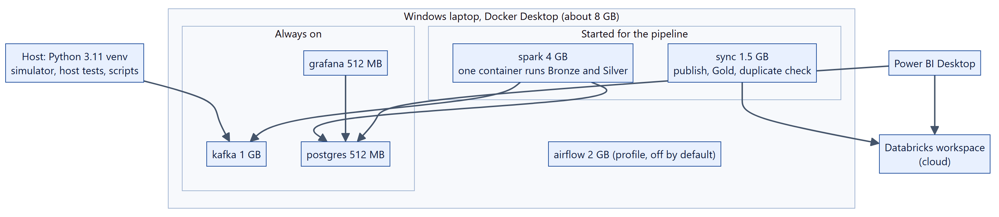

*Figure 26. Docker services and their memory limits on the laptop, and what connects to the cloud.*

### Appendix F. Related documents in the repository

| Document | Content |
|---|---|
| `README.md` | Overview and quick start |
| `docs/RUNNING.md` | The full running guide with measured numbers |
| `docs/metrics.md` | The metric dictionary |
| `docs/superpowers/specs/2026-10-04-funnelstream-design.md` | The design specification |
| `docs/superpowers/specs/2026-10-10-inventory-two-users-design.md` | The inventory and two-user design |
| `docs/superpowers/specs/2026-10-12-powerbi-redesign-design.md` | The Power BI redesign |
| `docs/data-model-review.md` | The 25-finding model review and its resolution status |
| `docs/PRE-DEFENSE-CHECKLIST.md` | The step list before the defense |
| `docs/benchmark.md` | The benchmark |
| `dashboards/powerbi/MODEL.md` | The Power BI model guide |
